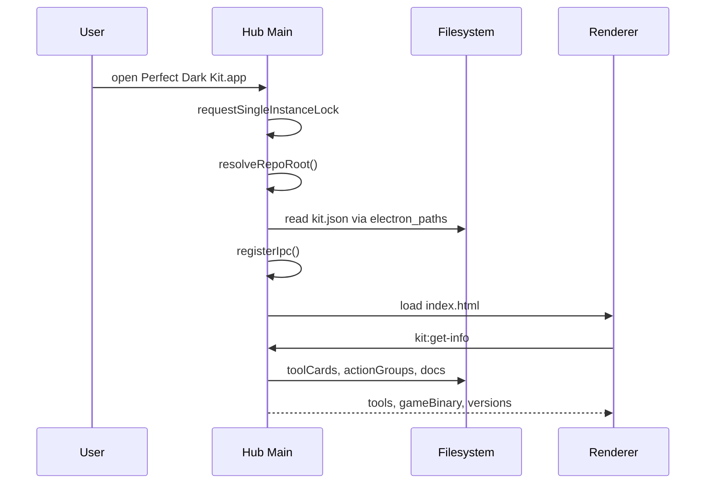
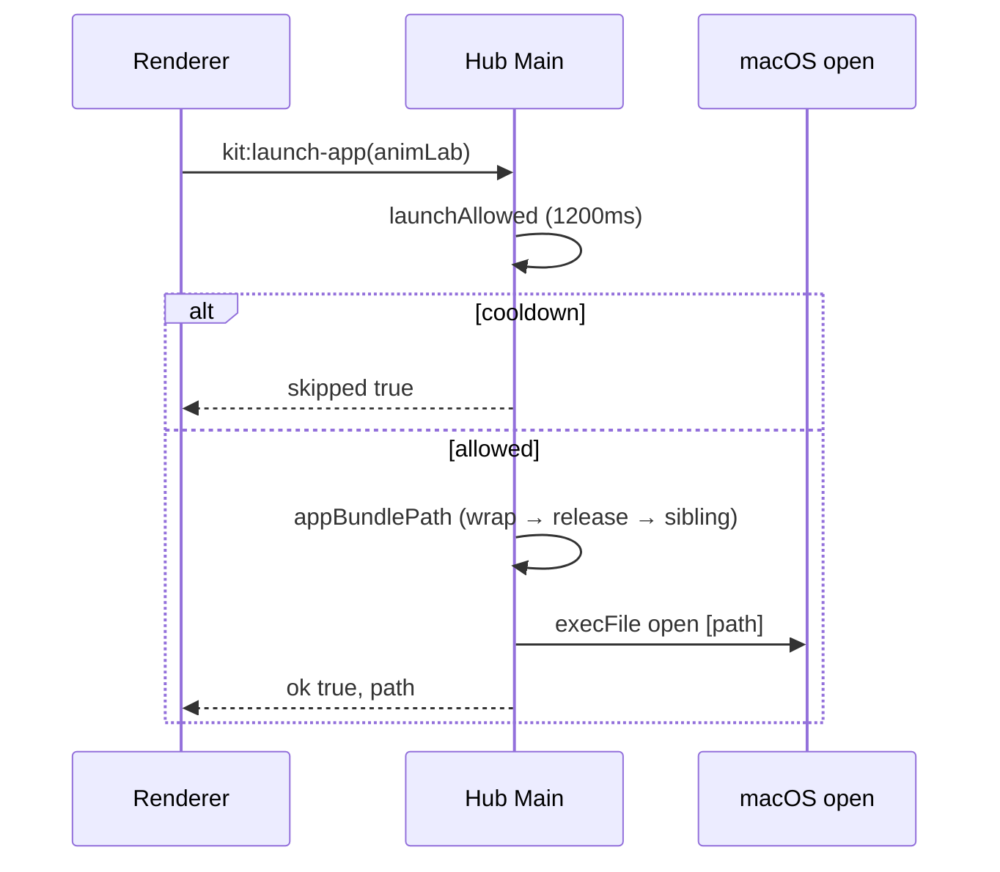
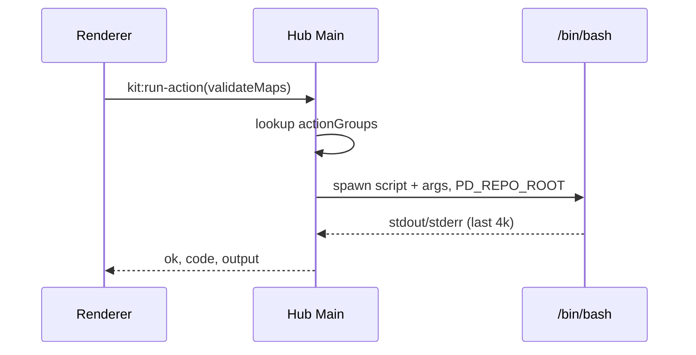

# Perfect Dark AIO — Architecture

**Parent spec:** [`SPEC.md`](SPEC.md)  
**API contracts:** [`API_CONTRACTS.md`](API_CONTRACTS.md)

---

## 1. Layer model

```
┌──────────────────────────────────────────────────────────────┐
│ L4  Presentation — Electron BrowserWindow + HTML/CSS/JS      │
│     tools/pd_kit/electron/renderer/                          │
│     journal/uff_viewer/uff_map.html  journal/anim_lab/*.html │
├──────────────────────────────────────────────────────────────┤
│ L3  Shell — main.js, preload, IPC, single-instance, bootstrap│
│     tools/pd_kit/electron_paths.js                           │
│     tools/pd_kit/electron_single_instance.js                 │
├──────────────────────────────────────────────────────────────┤
│ L2  Local services — Python HTTP servers, venv tools           │
│     journal/uff_viewer/serve_editor.py  serve_animlab.py     │
│     tools/asset_upgrader/  tools/pdmap/                      │
├──────────────────────────────────────────────────────────────┤
│ L1  Game runtime — build/pd.arm64, mods/, data/ROM           │
│     port/src/  src/levels/  mods/mod_allinone/               │
├──────────────────────────────────────────────────────────────┤
│ L0  Build & manifest — bash scripts, kit.json, CMake         │
│     scripts/build-pd-kit.sh  scripts/pd-kit-common.sh        │
└──────────────────────────────────────────────────────────────┘
```

**Dependency rule:** L4 never imports L2 directly — only via HTTP localhost or IPC to L3.

---

## 2. Repository map (authoritative paths)

### 2.1 Manifest & shared kit modules

| Path | Layer | Role |
|------|-------|------|
| `tools/pd_kit/kit.json` | L0 | App registry, actions, docs |
| `tools/pd_kit/electron_paths.js` | L3 | Node: manifest, logs, state dirs |
| `tools/pd_kit/paths.py` | L2 | Python mirror of paths + state |
| `tools/pd_kit/electron_single_instance.js` | L3 | `requestSingleInstanceLock` |
| `KIT_VERSION` | L0 | Semver for kit tooling |
| `PORT_VERSION` | L0 | Semver for game fork |

### 2.2 Electron applications

| App | main.js | preload | package.json appId |
|-----|---------|---------|-------------------|
| Kit Hub | `tools/pd_kit/electron/main.js` | `preload.js` | `com.perfectdark.kit` |
| Map Editor | `journal/uff_viewer/electron/main.js` | `preload.js` | `com.perfectdark.kit.map-editor` |
| Anim Lab | `journal/anim_lab/electron/main.js` | `preload.js` | `com.perfectdark.kit.anim-lab` |
| Asset Upgrader | `tools/asset_upgrader/electron/` | — | per package.json |
| Agent Office | `tools/agent-office-electron/` | — | per package.json |

### 2.3 Python servers

| Server | File | Default port | Port range | Health service |
|--------|------|--------------|------------|----------------|
| Map Editor | `journal/uff_viewer/serve_editor.py` | 8765 | 8765–8775 | `uff-editor` |
| Anim Lab | `journal/anim_lab/serve_animlab.py` | 8776 | 8776–8795 | `anim-lab` |

Port files: `.editor_server.port`, `.anim_lab_server.port` in respective state dirs.

### 2.4 Game & mods

| Path | Role |
|------|------|
| `port/` | PC port C sources (fork of upstream perfect_dark) |
| `src/levels/` | Python level modules (uff, animlab, agent_office, …) |
| `mods/mod_allinone/` | Primary deploy target for custom assets |
| `build/pd.arm64` | Compiled game binary (cmake target `pd`) |
| `data/pd.ntsc-final.z64` | External ROM (symlink via link-rom.sh) |

### 2.5 Scripts (L0 orchestration)

| Script | Purpose |
|--------|---------|
| `scripts/build-pd-kit.sh` | Full kit orchestrator |
| `scripts/build-pd-kit-launcher-electron.sh` | Hub + wrap children |
| `scripts/build-map-editor-electron.sh` | Map Editor .app |
| `scripts/build-anim-lab-electron.sh` | Anim Lab .app |
| `scripts/pd-kit-common.sh` | Shared constants, manifest writer, prune |
| `scripts/pd-kit.sh` | CLI open/validate wrapper |
| `scripts/pd-kit-icons.sh` | ICNS generation |

### 2.6 Sibling (optional)

`../llm-play/` — LLM Play.app; referenced by `kit.json` `llmPlay.siblingPath`.

---

## 3. Kit hub — sequence diagrams

### 3.1 Bootstrap



### 3.2 Launch child app



### 3.3 Run pipeline action



---

## 4. Python-backed app — state machine

Used by **Map Editor** and **Anim Lab** (nearly isomorphic).

```
                    ┌─────────────┐
                    │   QUIT      │
                    └─────────────┘
                          ▲
                          │ before-quit: kill server if spawned
                          │
┌──────────┐  whenReady   ┌──────────────┐
│  START   │─────────────►│ BOOTSTRAPPING│
└──────────┘              └──────┬───────┘
                                 │ ensureBootstrap mutex
                                 ▼
                          ┌──────────────┐     health ok on scan
                          │ SCAN_PORTS   │────────────────────┐
                          └──────┬───────┘                    │
                                 │ no healthy server           │
                                 ▼                             │
                          ┌──────────────┐                    │
                          │ SPAWN_PYTHON │                    │
                          └──────┬───────┘                    │
                                 │ waitForServerReady          │
                                 ▼                             ▼
                          ┌──────────────────────────────────────┐
                          │           READY (activePort set)      │
                          │  createWindow → loadURL localhost   │
                          └──────────────────┬───────────────────┘
                                             │ server exit
                                             ▼
                          ┌──────────────┐
                          │   RESTART    │ (≤ MAX_RESTART_ATTEMPTS)
                          └──────────────┘
```

**Constants:**

| App | PORT_MIN | PORT_MAX | MAX_RESTART | BUNDLED_SUBDIR |
|-----|----------|----------|-------------|----------------|
| Map Editor | 8765 | 8775 | 3 | `editor` |
| Anim Lab | 8776 | 8795 | 3 | `anim-lab` |

---

## 5. Repo root discovery — comparison

| Source | Hub | Map Editor | Anim Lab |
|--------|-----|------------|----------|
| `PD_REPO_ROOT` | ✓ | ✓ | ✓ |
| Baked `repo-config.json` | ✓ | ✓ | ✓ |
| Marker file | `tools/pd_kit/kit.json` | `serve_editor.py` in bundle | `journal/anim_lab/serve_animlab.py` |
| Max walk depth | 14 | 12 | 12 |
| iCloud normalize | ✓ | ✓ | ✓ |

---

## 6. Writable state directory resolution

**Function:** `resolveKitStateDir()` (JS) / `resolve_*_state_dir()` (Python)

```
1. If env PD_*_STATE_DIR set → use it (mkdir -p)
2. Else if repo/journal/<app>/ writable (probe file .pd_kit_write_probe) → use repo path
3. Else if legacy Application Support dir non-empty and kit dir empty → legacy
4. Else ~/Library/Application Support/PerfectDarkKit/<id>/
```

| Component | Env override | Repo-relative default | Legacy support |
|-----------|--------------|----------------------|----------------|
| Map Editor | `PD_EDITOR_STATE_DIR` | `journal/uff_viewer/` | PerfectDarkMapEditor |
| Anim Lab | `PD_ANIM_LAB_STATE_DIR` | `journal/anim_lab/` | PerfectDarkAnimLab |

**Artifacts in state dir:**

| File | Owner |
|------|-------|
| `.editor_server.port` | Map Editor |
| `.anim_lab_server.port` | Anim Lab |
| `last_deploy.json` | Anim Lab |
| `.last_play.sh` | Both (replay) |

---

## 7. pdmap pipeline — data flow

```
EditorMapSpec / map.json
        │
        ▼
tools/pdmap/from_json.py  ──► EditorMapSpec (auto-fix Y pads)
        │
        ▼
tools/pdmap/validate.py   ──► errors (non-contiguous pads, CTF, …)
        │
        ▼
tools/pdmap/pipeline.py   ──► SEG (PDMAP_SEG_MODE, SEG_SCRIPT)
        │
        ├──► tools/pdmap/builders.py (tiles, pads, setup)
        │
        ▼
mods/mod_allinone/        ──► asset files (setup, pads, lang, …)
        │
        ▼
build/pd.arm64 --moddir   ──► runtime load
```

**Learn engine:** `tools/pdmap/learn/` runs probes → regenerates `docs/MAP_DETERMINISTIC_SPEC.md`.

**Human workflow:** `docs/MAP_MAKING_WIKI.md`.

---

## 8. Release bundle anatomy

```
scripts/release/
├── Perfect Dark Kit.app/
│   └── Contents/
│       ├── MacOS/Perfect Dark Kit
│       ├── Resources/
│       │   ├── pd_kit/kit.json
│       │   ├── pd_kit/electron_paths.js
│       │   ├── repo-config.json
│       │   ├── kit-manifest.json
│       │   └── Apps/
│       │       ├── PD Map Editor.app/
│       │       ├── PD Anim Lab.app/
│       │       └── …
│       └── Info.plist
├── PD Map Editor.app/
│   └── Contents/Resources/editor/   ← serve_editor + uff_map.html
├── PD Anim Lab.app/
│   └── Contents/Resources/anim-lab/
└── kit-manifest.json
```

Repo root symlink: `Perfect Dark Kit.app` → `scripts/release/Perfect Dark Kit.app`.

---

## 9. Build pipeline graph

```
pd-kit-icons.sh (all)
        │
        ├── build-map-editor-electron.sh ──► PD Map Editor.app
        ├── build-anim-lab-electron.sh   ──► PD Anim Lab.app
        ├── build-agent-office-electron.sh
        ├── build-asset-upgrader-electron.sh
        ├── build-map-editor-app.sh (Play Last Test Map)
        └── build-llm-play-electron.sh (optional)
        │
        ▼
build-pd-kit-launcher-electron.sh
        │
        ├── electron-builder (hub)
        ├── copy wraps → Resources/Apps/*
        ├── write repo-config.json
        └── write_kit_release_manifest
        │
        ▼
kit_prune_electron_staging_dirs + kit_prune_repo_root_app_clutter
```

---

## 10. Version & config propagation

| Artifact | Written by | Read by |
|----------|------------|---------|
| `KIT_VERSION` | Manual bump | Hub UI, manifest, logs |
| `PORT_VERSION` | Manual bump | Hub UI, manifest |
| `repo-config.json` | Each electron build script | Electron `readBakedRepoRoot()` |
| `kit-manifest.json` | `write_kit_release_manifest` | Hub `gameBinaryPath()`, external audit |
| `PD_REPO_ROOT` | User/dev shell | Overrides baked root |

---

## 11. Security & trust boundaries

| Boundary | Configuration | Risk |
|----------|---------------|------|
| Hub renderer | `nodeIntegration: false`, `contextIsolation: true`, `sandbox: false` | Preload is trust boundary |
| Anim Lab renderer | `sandbox: true`, `contextIsolation: true` | Reduced renderer privilege |
| Local HTTP | Bind 127.0.0.1; Origin check | LAN exposure if misconfigured |
| Hub shell actions | User-level bash, no sudo | User can run any repo script |
| ROM | User-supplied, gitignored | Legal/compliance on user |

---

## 12. Extension points

| Add… | Required touches |
|------|------------------|
| New kit app | `kit.json` apps + `kitHub.wraps` + build script + icon + STORIES + SPEC §13.5 |
| New hub action | `kit.json` actionGroups + SPEC §19 row |
| New HTTP endpoint | Server py + API_CONTRACTS.md + STORIES if user-facing |
| New map invariant | pdmap probe + `learn run` + MAP_DETERMINISTIC_SPEC |
| New Electron app | Copy anim_lab main.js patterns (SPEC §14) + electron_paths |

---

## 13. Module dependency graph (Python)

```
tools/pd_kit/paths.py
        ▲
        │ kit_log_file, resolve_*_state_dir
        │
serve_editor.py ──► test_map.py ──► tools/pdmap/*
serve_animlab.py ──► tools/pdmap/anim_catalog.py
                   └─► tools/pdmap/play.py
tools/pdmap.py ──► validate, pipeline, deploy
```

---

## 14. Electron technology stack

| Package | Version (hub) | Notes |
|---------|---------------|-------|
| electron | ^33.2.1 | Unhandled rejection = fatal if uncaught |
| electron-builder | ^25.1.8 | `mac dir` target, arm64+x64 |
| Node | LTS recommended | For build only |

---

## Revision history

| Date | Change |
|------|--------|
| 2026-07-02 | State machines, bundle anatomy, port tables, discovery matrix |
| 2026-07-02 | Initial architecture doc |
