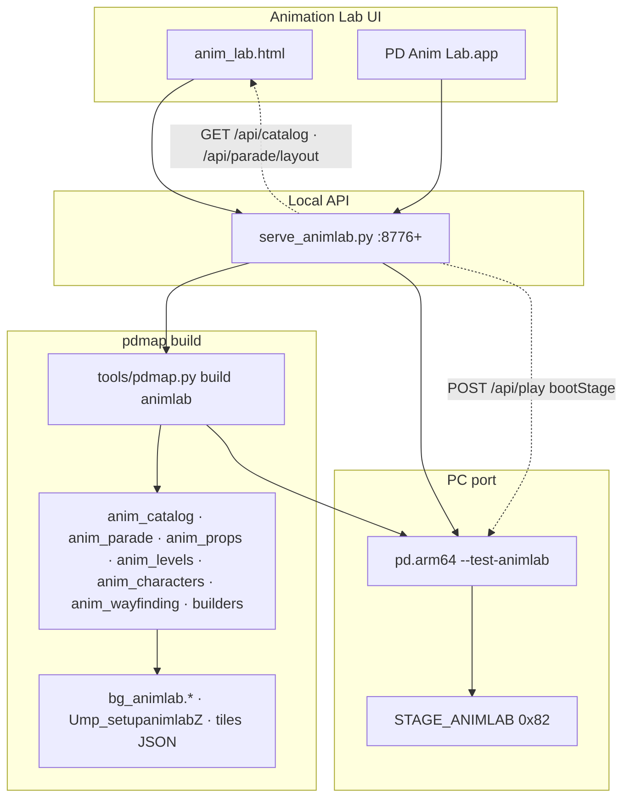
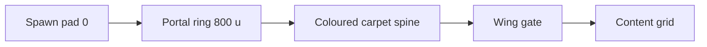

# Anim Lab — Specification (SDD Canonical)

**Status:** Active  
**Version:** 1.1.0  
**Last updated:** 2026-07-02  

---

## Related documents

| Document | Role |
|----------|------|
| **This file** | Requirements, data contracts, acceptance criteria, verification gates. |
| [`ANIMLAB_VISION.md`](ANIMLAB_VISION.md) | North-star narrative and honest limits (non-normative). |
| [`ANIMLAB_MASTER_PLAN.md`](ANIMLAB_MASTER_PLAN.md) | Layout contract — coordinates, room budget, district/tag tables, carpet palette. |
| [`CHARACTER_ANIMATIONS.md`](CHARACTER_ANIMATIONS.md) | Animation pipeline study guide and build commands. |
| [`MAP_DETERMINISTIC_SPEC.md`](MAP_DETERMINISTIC_SPEC.md) | pdmap/build invariants (pads, tiles, seg, validate). |

**Precedence:** SPEC > MASTER_PLAN > VISION for requirements and acceptance. MASTER_PLAN wins for exact coordinates and room allocation unless this document explicitly supersedes with a version bump.

---

## 1. Document control

### 1.1 Glossary

| Term | Definition |
|------|------------|
| **STAGE_ANIMLAB** | Retail stage id `0x82`; in-engine museum world (`--test-animlab`). |
| **Spawn hub** | Room 1 plaza centred on pad **0** at `(0, 10, −2200)`; ±500 u clearance never carved. |
| **Portal ring** | Eight compass portal arches at **800 u** radius (`PARADE_HUB_SIGNPOST_RADIUS`). |
| **Pad** | Spawn/prop anchor index; walkable spawns use **Y=10** (floor search requires pad Y > floor Y). |
| **Tile room** | Collision/draw partition; Anim Lab uses rooms **1–24** (room **0** = engine void). |
| **Wing** | One of eight compass content districts (N, SW, W, WSW, E, NE, NW, SE). |
| **Footprint island** | Level-world marker: coloured floor tile + door-console prop; no embedded bg geometry. |
| **Showcase scale** | StdObject with shrink heuristic (`model_showcase_extents`) — **W** catalog. |
| **True scale** | StdObject at retail extrascale + bbox half-extents — **NW** yards. |
| **Parade grid** | Guard chr loops in animation districts (pads **1–170**). |
| **Full-tour cycler** | Single chr cycling parade-usable anims in ROM order (pad **171**). |
| **Sub-zone** | ≤30 chr tile room within a district (rooms **2–13**). |
| **Tag district** | Object-catalog cluster by `stdobject_models.json` tag (7 active tags). |
| **Megaworld** | Combined level islands in tile room **18** (solo + MP + dev). |
| **Wayfinding spine** | Coloured carpet corridor from hub to wing gate (`spawn_corridor_routes`). |
| **Gate** | Wing entrance prop cluster (`wing_gate_entries`). |
| **Beacon** | Distance marker every **2000 u** on routes ≥ **3000 u** (`distance_beacon_placements`). |
| **Boot stage** | UI/CLI launch of a retail stage via `--boot-stage 0xNN`. |

### 1.2 Canonical content baselines

Counts below are derived from `tools/pdmap/*.py` at build time. Re-run §11.2 audit after any layout change.

| Metric | Value | Source |
|--------|------:|--------|
| ROM animations (total) | **1207** | `animations.json` |
| Named ROM animations | **579** | excludes `ANIM_XXXX` stubs |
| Guard-playable parade slots | **170** | `NUM_GRID_SLOTS` |
| Phase 4 parade target | **571** | full grid + cutscene bodies (deferred) |
| CUT_* ROM clips (frames > 0) | **392** | `_cutscene_rom_count()` |
| StdObjects (W + NW) | **352** each | `stdobject_models.json` |
| True-scale split | **163** normal · **189** mega | `_true_scale_wing_counts()` |
| Level islands | **91** | **25** solo · **26** MP · **40** dev |
| Character mannequins | **24** | `MAIN_CHARACTER_ENTRIES` |
| Hub props (SW) | **8** | `_gallery_grid_specs()` |
| Corridor props (north spine) | **4** | `PARADE_CORRIDOR_COMPUTER_SPECS` |
| District vignettes | **16** | `_vignette_specs()` |
| StdObject prop specs (total) | **737** | `all_parade_prop_specs()` |
| Carpet routes | **9** | `spawn_corridor_routes()` |
| Wing gates | **9** | `wing_gate_entries()` |
| Distance beacons | **57** | `distance_beacon_placements()` |
| Hub signposts | **8** | `hub_signpost_entries()` |
| Tile rooms allocated | **24 / 24** | full budget |
| Last pad index | **1023** | pads **933–1023** = level islands |

**Pad chain:** **0** spawn · **1–170** parade · **171** tour · **172–908** props · **909–932** characters · **933–1023** levels.

District grids, tag-room tables, and coordinate anchors: [`ANIMLAB_MASTER_PLAN.md`](ANIMLAB_MASTER_PLAN.md).

---

## 2. Problem statement & goals

### 2.1 Why Anim Lab exists

Perfect Dark ships **1207** animations, **352** StdObjects, **91** retail/dev stages, and **24** playable character bodies. Isolated inspection loses spatial context. Anim Lab provides one walkable museum (`STAGE_ANIMLAB`) where each compass direction answers exactly one content question, mirrored by the Animation Lab UI.

### 2.2 Primary users

| User | Goal |
|------|------|
| **Modder** | Find model ids, stage hex, prop scale; boot retail stages from island markers. |
| **Animator** | Browse guard-playable loops by category; study computer/console anims with prop context. |
| **Level browser** | Index all `stagetable.c` stages as footprint islands; compare solo vs MP vs dev taxonomies. |

### 2.3 Goals

| ID | Statement | Priority |
|----|-----------|----------|
| **G-1** | Player reaches every wing on foot without fall-through; collision audit returns **0 errors**. | MUST |
| **G-2** | Eight compass directions each serve exactly one content class with immutable carpet palette. | MUST |
| **G-3** | UI Parade tab matches in-game signposts (names, colours, live counts). | MUST |
| **G-4** | Layout rebuilds deterministically via `python3 tools/pdmap.py build animlab --seg --deploy`. | MUST |
| **G-5** | Player does not die from void fall on `STAGE_ANIMLAB`. | MUST |

### 2.4 Non-goals

| Non-goal | Rationale |
|---------|-----------|
| Embedded retail level geometry in islands | One bg file per stage; footprints + `--boot-stage` only. |
| **571** guard-playable grid today | **170** playable; **392** CUT_* + cinematic/Skedar/bike rigs excluded. Phase 4. |
| In-map stage warp pads | `portalSupport: false` in layout payload; deferred Phase 3+. |
| eld/lip object tag districts | Tags defined; **0** models; room budget full (**24/24**). |
| Runtime world text billboards | Engine limit — colour + prop silhouette + UI labels only. |
| Third 352-prop object wing | W (showcase) + NW (true-scale) only; SW is curated props. |

---

## 3. System overview

### 3.1 Architecture



### 3.2 Navigation flow



### 3.3 Component ownership

| Module | Responsibility |
|--------|----------------|
| `anim_catalog.py` | Animation taxonomy, district grid, parade slots, hub signposts, rooms **2–13** |
| `anim_parade.py` | Chr guards, ailists, pads **1–171**, tour cycler |
| `anim_props.py` | StdObjects: hub, catalog, true-scale, gates, beacons, signposts |
| `museum_layout.py` | Bbox packing, tag districts, s16 caps, catalog hub coordinates |
| `anim_levels.py` | Solo/MP/dev worlds, bridges, room **18**, level pads **933+** |
| `level_footprints.py` | Pad JSON → island half-extents |
| `anim_characters.py` | 24 mannequins, room **19**, pads **909–932** |
| `anim_wayfinding.py` | Carpet routes, compass rose, gates, beacons, walk/collision audits |
| `builders.py` | `floor_box_with_parade_zones()` — tiles, carve/restore collision |
| `validate.py` | Mapdef + animlab collision/walk audits |
| `anim_layout_geometry.py` | Map Editor overlay export |
| `journal/anim_lab/anim_lab.html` | Parade UI, compass chips, spatial map, boot-stage |
| `journal/anim_lab/serve_animlab.py` | HTTP API, build/play orchestration |
| `src/levels/animlab.py` | Level module: `build_tiles_json()`, arena shell |

---

## 4. Functional requirements

Each requirement is a single verifiable statement. Layout tables live in MASTER_PLAN; counts in §1.2.

### FR-001 — Spawn hub & plaza

| ID | Requirement | Priority |
|----|-------------|----------|
| FR-001.1 | Player spawn is pad **0** at `(0, 10, −2200)`. | MUST |
| FR-001.2 | Spawn plaza preserves ±**500 u** clearance (`spawn_plaza_bounds()`); no solid props carved inside. | MUST |
| FR-001.3 | Hub exposes eight compass portal targets at **800 u** ring radius. | MUST |
| FR-001.4 | Full-tour cycler occupies pad **171** at `(600, −2200)` with gold carpet. | MUST |
| FR-001.5 | Main walk spines are **500 u** wide (`PARADE_CORRIDOR_HALF_WIDTH = 250`). | MUST |

### FR-002 — Eight compass navigation

| Compass | Label | Carpet | Content |
|---------|-------|--------|---------|
| **N** | Animation districts | `#a78bfa` | Guard animation loops |
| **SW** | Props gallery | `#38bdf8` | Curated furniture + vignettes |
| **W** | Object catalog | `#0ea5e9` | 352 StdObjects @ showcase scale |
| **WSW** | Solo world | `#f59e0b` | **25** campaign footprint islands |
| **E** | MP world | `#dc2626` | **26** MP / test MP islands |
| **NE** | Dev annex | `#64748b` | **40** dev / GEX / mod islands |
| **NW** | True scale | `#14b8a6` / `#0d9488` | 352 @ bbox (163 normal + 189 mega) |
| **SE** | Character gallery | `#c084fc` | 24 character mannequins |

| ID | Requirement | Priority |
|----|-------------|----------|
| FR-002.1 | Each compass maps to exactly one content class. | MUST |
| FR-002.2 | Signpost hint follows `{COMPASS} → {Label} ({cardinal hint}, ~{distance} u)` (`hub_signpost_entries()`). | MUST |
| FR-002.3 | NW exposes `subTargets` for **NW-N** (normal) and **NW-W** (mega). | MUST |

### FR-003 — Animation districts

| ID | Requirement | Priority |
|----|-------------|----------|
| FR-003.1 | **170** guard-playable animation slots occupy category districts north of hub. | MUST |
| FR-003.2 | Guards split into tile rooms **2–13** with ≤**30** chr per room (`PARADE_MAX_CHR_PER_ZONE`). | MUST |
| FR-003.3 | District grid origin is `(−2250, −900)`; cell size **1500×1200 u**. | MUST |
| FR-003.4 | Cutscene district row remains reserved with **0** playable slots until Phase 4. | MUST |
| FR-003.5 | Full-tour cycler cycles parade-usable anims in ROM index order. | SHOULD |

District slot breakdown (10 districts, 12 sub-zones): MASTER_PLAN § Current state.

### FR-004 — Props gallery (SW)

| ID | Requirement | Priority |
|----|-------------|----------|
| FR-004.1 | Hub furniture gallery centres at `(−2200, −3000)` in room **1**. | MUST |
| FR-004.2 | **8** hub props (pads **172–179**) occupy a spaced 3×3 grid with walk-through alcove. | MUST |
| FR-004.3 | **4** north-corridor computer props flank the spine (pads **180–183**). | MUST |
| FR-004.4 | **16** district vignettes offset from walk paths (pads **184–199**). | MUST |
| FR-004.5 | SW does not duplicate the 352-model object catalog. | MUST |

### FR-005 — Object catalog (W)

| ID | Requirement | Priority |
|----|-------------|----------|
| FR-005.1 | All **352** placable StdObjects display at showcase scale. | MUST |
| FR-005.2 | Models pack into **7** tag districts (rooms **14–15, 20–24**). | MUST |
| FR-005.3 | Catalog hub anchors at `(−21000, −26500)`. | MUST |
| FR-005.4 | Each tag room stays ≤**200** props (`PARADE_PROP_MAX_PER_ROOM`). | MUST |

Tag district model counts: MASTER_PLAN § Object catalog tag districts.

### FR-006 — True-scale yard (NW)

| ID | Requirement | Priority |
|----|-------------|----------|
| FR-006.1 | All **352** models place at retail extrascale (no showcase shrink). | MUST |
| FR-006.2 | Normal wing (**163** models) centres `(15000, −20000)`, room **16**. | MUST |
| FR-006.3 | Mega yard (**189** models, peak half > 450 u) anchors `(−29000, −29000)`, room **17**. | MUST |
| FR-006.4 | Mega carpet is s16-clamped via `museum_s16_half_cap()`. | MUST |
| FR-006.5 | `verify_museum_placements()` reports **0** AABB overlaps. | MUST |

### FR-007 — Character gallery (SE)

| ID | Requirement | Priority |
|----|-------------|----------|
| FR-007.1 | **24** mannequins display on distinct `BODY_*` rigs. | MUST |
| FR-007.2 | Gallery centres `(5500, −4500)`, room **19**, purple carpet `#c084fc`. | MUST |
| FR-007.3 | Idle anim is `ANIM_TWO_GUN_HOLD` loop per chr. | MUST |
| FR-007.4 | Groups: joanna (6), allies (8), villains (6), guards (4). | MUST |

### FR-008 — Level worlds (WSW / E / NE)

| ID | Requirement | Priority |
|----|-------------|----------|
| FR-008.1 | One footprint island emits per `stagetable.c` row except `STAGE_ANIMLAB` (**91** total). | MUST |
| FR-008.2 | Solo world uses gold carpet, gate `(−4200, −5200)`, grid origin `(−15800, −8800)`. | MUST |
| FR-008.3 | MP world uses crimson carpet, gate `(9200, −2800)`, origin `(21800, −3200)`. | MUST |
| FR-008.4 | Dev annex uses slate carpet, gate `(5200, 3600)`, origin `(15200, 11800)`. | MUST |
| FR-008.5 | Islands are marker-only (footprint + door-console prop); `portalSupport: false`. | MUST |
| FR-008.6 | All island props live in tile room **18** (≤200 props). | MUST |
| FR-008.7 | UI offers per-island **Boot stage** → `--boot-stage 0xNN`. | MUST |

World split: **25** solo · **26** MP · **40** dev (`megaworld_plan()`).

### FR-009 — Full-tour cycler

| ID | Requirement | Priority |
|----|-------------|----------|
| FR-009.1 | Pad **171** chr cycles parade-usable anims sequentially. | MUST |
| FR-009.2 | Tour ailists may chunk at `PARADE_TOUR_CHUNK_SIZE = 100` entries. | MAY |

### FR-010 — In-game wayfinding

| ID | Requirement | Priority |
|----|-------------|----------|
| FR-010.1 | **9** carpet corridor routes paint from spawn (`spawn_corridor_routes`). | MUST |
| FR-010.2 | **9** wing gates place at district entrances (`wing_gate_entries`). | MUST |
| FR-010.3 | Distance beacons emit every **2000 u** on routes ≥ **3000 u** (**57** beacons today). | MUST |
| FR-010.4 | Compass rose renders at spawn (radius **170 u**, inner **28 u**). | MUST |
| FR-010.5 | Floor rule: **Y=0** collision quad under every walkable carpet; carpet overlay at **Y=4** (`marker_y`). | MUST |
| FR-010.6 | `in_game_guide_payload().walkHint` uses live level counts from `megaworld_plan()`. | MUST |

### FR-011 — Animation Lab UI

| ID | Requirement | Priority |
|----|-------------|----------|
| FR-011.1 | Parade tab exposes compass chips 1:1 with `hub_signpost_entries()`. | MUST |
| FR-011.2 | Spatial map legend uses same palette and labels as signposts. | MUST |
| FR-011.3 | In-game guide panel lists all 8 directions with live counts from layout payload. | MUST |
| FR-011.4 | District chips appear when **N** selected; tag chips when **W** selected. | MUST |
| FR-011.5 | Deep links support `?compass=N` and `?district=__tag_furniture`. | MUST |
| FR-011.6 | Boot stage button POSTs `/api/play` with `bootStage: "0xNN"`. | MUST |
| FR-011.7 | Build & Play deploys to `mods/mod_allinone` and launches `--test-animlab`. | MUST |
| FR-011.8 | Full catalog tab searches all named ROM anims (`/api/animations`). | SHOULD |

### FR-012 — Build & Play pipeline

| ID | Requirement | Priority |
|----|-------------|----------|
| FR-012.1 | Build command is `python3 tools/pdmap.py build animlab --seg --deploy --mod mod_allinone`. | MUST |
| FR-012.2 | Play command is `./build/pd.arm64 --test-animlab --moddir mods/mod_allinone --solo --num-sims 0`. | MUST |
| FR-012.3 | `serve_animlab.py` rebuilds `pd.arm64` when engine sources are newer than binary. | MUST |
| FR-012.4 | Parade cap honours `ANIMLAB_PARADE_MAX` (default **570** env; effective playable **170**). | SHOULD |

### FR-013 — Map Editor layout import

| ID | Requirement | Priority |
|----|-------------|----------|
| FR-013.1 | `GET /api/preview-geometry` exports read-only overlay (tiles, pads, districts, props). | MUST |
| FR-013.2 | Map Editor consumes overlay via **Import Anim Lab layout** or `?import=animlab`. | SHOULD |
| FR-013.3 | Overlay is not editable in Map Editor — layout changes via pdmap Python only. | MUST |

### FR-014 — Collision & floor invariants

| ID | Requirement | Priority |
|----|-------------|----------|
| FR-014.1 | `_ensure_animlab_walk_collision_floors()` restores room-1 **Y=0** quads on all audited spines. | MUST |
| FR-014.2 | Megaworld room **18** carve does not leave fall-through on hub spines. | MUST |
| FR-014.3 | `audit_spawn_collision_floor()` returns **0** errors at release gate. | MUST |
| FR-014.4 | Walkable carpet does not exist without underlying **Y=0** collision on audited routes. | MUST |

### FR-015 — Safety (no void death)

| ID | Requirement | Priority |
|----|-------------|----------|
| FR-015.1 | On `STAGE_ANIMLAB`, player does not die from 4-second void fall (`bondwalk.c` guard). | MUST |
| FR-015.2 | Fall damage on landing is suppressed on `STAGE_ANIMLAB`. | MUST |

---

## 5. Non-functional requirements

### NFR-001 — Performance & render

| ID | Requirement | Priority |
|----|-------------|----------|
| NFR-001.1 | Draw distance is **48000 u** (`ANIMLAB_DRAW_DIST` in `constants.h`; z-far matches in `env.c`). | MUST |
| NFR-001.2 | Arena half-extent is ≤**32000 u** (s16 tile vertex budget). | MUST |
| NFR-001.3 | PC port uses `Game.MemorySize` ≥ **256** MB for full parade load. | SHOULD |
| NFR-001.4 | `STAGE_ANIMLAB` render path bypasses room culling limits (propsSort, GDL guard, NOSHADOW). | MUST |

### NFR-002 — Deterministic build

| ID | Requirement | Priority |
|----|-------------|----------|
| NFR-002.1 | Layout is reproducible from `tools/pdmap/*.py` without manual JSON edits. | MUST |
| NFR-002.2 | `megaworld_plan()` derives stage list from `src/game/stagetable.c` parse order. | MUST |
| NFR-002.3 | Object catalog derives from `tools/pdmap/data/stdobject_models.json`. | MUST |

### NFR-003 — Engine & coordinate limits

| ID | Requirement | Priority |
|----|-------------|----------|
| NFR-003.1 | Tile vertex coordinates stay within s16 range (±32767); use `museum_s16_half_cap()`. | MUST |
| NFR-003.2 | Chr per tile room ≤ **30** (`propnums[256]` overflow guard). | MUST |
| NFR-003.3 | Props per tile room ≤ **200** (recommend ≤180 headroom). | MUST |
| NFR-003.4 | Pad indices are contiguous **0..N−1** per `validate_mapdef`. | MUST |
| NFR-003.5 | Spawn pads use **Y=10** (`PAD_FLOOR_OFFSET`). | MUST |

### NFR-004 — Room budget

Room allocation table: MASTER_PLAN § Room budget.

| ID | Requirement | Priority |
|----|-------------|----------|
| NFR-004.1 | Content rooms **1–19** plus tag rooms **20–24** = **24/24** allocated; no spare room without reallocation. | MUST |

### NFR-005 — Accessibility & UI

| ID | Requirement | Priority |
|----|-------------|----------|
| NFR-005.1 | Compass chips encode colour in border + active state (not colour alone). | SHOULD |
| NFR-005.2 | Error surfaces (build fail, missing binary) return actionable messages in API + UI log. | MUST |
| NFR-005.3 | UI follows Apple HIG patterns where applicable (contrast, readable type, clear hierarchy). | SHOULD |

---

## 6. Data contracts

### DC-001 — Pad index ranges

| Block | Start | End | Count | Owner |
|-------|------:|----:|------:|-------|
| Player spawn | **0** | **0** | 1 | `anim_parade.py` |
| Parade grid | **1** | **170** | 170 | `anim_parade.py` |
| Full-tour cycler | **171** | **171** | 1 | `anim_parade.py` |
| StdObject props | **172** | **908** | 737 | `anim_props.py` |
| Character gallery | **909** | **932** | 24 | `anim_characters.py` |
| Level islands | **933** | **1023** | 91 | `anim_levels.py` |

Chrnums: parade **0x50+**, tour **0x50+170**, characters after tour block.

### DC-002 — HTTP API (`serve_animlab.py`)

Default host: `127.0.0.1`, port **8776** (`--auto-port` scans +19).

| Method | Path | Response |
|--------|------|----------|
| GET | `/api/health` | Service probe, binary path, `stageAnimlab` |
| GET | `/api/status` | Running game PIDs |
| GET | `/api/catalog` | Full catalog + `paradeLayout` |
| GET | `/api/parade/layout` | **`parade_layout_payload()` only** (alias) |
| GET | `/api/play-config` | Map presets, mods, defaults |
| GET | `/api/showcase` | Parade guard list |
| GET | `/api/animations` | Search (`search`, `category`, `limit`, `namedOnly`) |
| GET | `/api/preview-geometry` | Map Editor overlay |
| POST | `/api/build` | `{ "level", "seg", "deploy" }` |
| POST | `/api/play` | Launch game (`bootStage` supported) |
| POST | `/api/launch` | Build + play unified |
| POST | `/api/replay` | Re-run `.last_play.sh` |
| POST | `/api/build-play` | Legacy alias → `/api/launch` |

#### DC-002.1 `/api/health`

```json
{
  "ok": true,
  "service": "anim-lab",
  "port": 8776,
  "repoRoot": "/path/to/repo",
  "binaryFound": true,
  "binaryPath": "/path/to/pd.arm64",
  "romid": "ntsc-final",
  "stageAnimlab": 130,
  "bootFlags": { "animlab": "--test-animlab", "uff": "--test-map" }
}
```

#### DC-002.2 `/api/catalog` (top-level)

```json
{
  "ok": true,
  "totalAnimations": 1207,
  "namedCount": 579,
  "paradeCount": 170,
  "parade": [{ "id": "ANIM_…", "index": 0, "paradeSlot": 1, "category": "…" }],
  "paradeLayout": { "slotCount": 170, "playerSpawn": { "x": 0, "z": -2200 } },
  "allSections": [{ "id": "…", "title": "…", "count": 0, "animations": [] }],
  "computerInteraction": { "count": 0, "ids": [], "animations": [] }
}
```

#### DC-002.3 `POST /api/play` (boot stage)

Request:

```json
{
  "level": "animlab",
  "bootStage": "0x4d",
  "solo": true,
  "numSims": 0,
  "scenario": 0,
  "mod": "mod_allinone"
}
```

Launches: `pd.arm64 --boot-stage 0x4d --skip-intro --scenario-0 --moddir mods/mod_allinone --solo --num-sims 0`

#### DC-002.4 `/api/preview-geometry`

```json
{
  "ok": true,
  "arenaHalf": 32000,
  "playerSpawn": { "x": 0, "z": -2200 },
  "layout": {},
  "pads": [{ "index": 0, "x": 0, "y": 10, "z": -2200, "room": 1, "kind": "spawn" }],
  "tileQuads": [{ "room": 1, "x0": 0, "z0": 0, "x1": 0, "z1": 0, "y": 0, "floorColour": 0 }],
  "walkableRegions": []
}
```

### DC-003 — Layout payload (`parade_layout_payload()`)

Fields consumed by `anim_lab.html`:

| Field | Type | Description |
|-------|------|-------------|
| `slotCount` | `int` | Parade grid slots (**170**) |
| `specialSlot` | `object` | Full-tour cycler pad/chr/coords |
| `districts` | `array` | Category district markers |
| `zones` | `array` | Sub-zone markers (**12**) |
| `propsDistrict` | `object` | SW hub props layout |
| `vignetteProps` | `object` | District entrance props (**16**) |
| `museumDistrict` | `object` | W catalog tag clusters |
| `trueScaleDistrict` | `object` | NW normal + mega wings |
| `levelMegaworldDistrict` | `object` | WSW/E/NE islands (**91**) |
| `characterDistrict` | `object` | SE gallery (**24**) |
| `hubSignposts` | `object` | Portal ring (`signs[]`, length **8**) |
| `inGameGuide` | `object` | Signposts + gates + beacons + routes + `walkHint` |
| `interactionRegistry` | `object` | District → prop/anim links |
| `walkableRegions` | `array` | Spatial map overlays |
| `slots` | `array` | Per-guard cell records |
| `playerSpawn` | `{x: number, z: number}` | `(0, −2200)` |
| `arenaHalf` | `number` | ≤32000 |

### DC-004 — Hub signpost entry

Each element of `hubSignposts.signs[]`:

```json
{
  "compass": "N",
  "label": "Animation districts",
  "hint": "N → Animation districts (north, ~1234 u)",
  "x": 0.0,
  "z": -1400.0,
  "targetX": -2250.0,
  "targetZ": -900.0,
  "distance": 1234,
  "color": "#a78bfa",
  "floorColour": 12345,
  "subTargets": []
}
```

`subTargets` is non-empty only for **NW** (`gate_true_scale_normal`, `gate_true_scale_mega`).

### DC-005 — Level island record

Each element of `levelMegaworldDistrict.islands[]`:

```json
{
  "pad": 933,
  "label": "Chicago",
  "symbol": "STAGE_CHICAGO",
  "stageHex": "0x05",
  "category": "solo",
  "world": "solo",
  "worldLabel": "Solo Campaign World",
  "x": -15800.0,
  "z": -8800.0,
  "y": 10.0,
  "room": 18,
  "half": 300.0,
  "halfX": 320.0,
  "halfZ": 280.0,
  "footprintWidth": 640.0,
  "footprintDepth": 560.0,
  "colour": "#f59e0b",
  "floorColour": 12345,
  "kind": "level_island",
  "hint": "Stage 0x05 — STAGE_CHICAGO (solo, solo)"
}
```

---

## 7. Zone map

Coordinate quick reference and ASCII wing map: MASTER_PLAN § Appendix.

| Feature | (x, z) |
|---------|--------|
| Player spawn | `(0, −2200)` |
| Portal ring radius | **800 u** |
| Full-tour cycler | `(600, −2200)` |
| District grid origin | `(−2250, −900)` |
| Props gallery | `(−2200, −3000)` |
| Object catalog hub | `(−21000, −26500)` |
| True-scale normal / mega | `(15000, −20000)` / `(−29000, −29000)` |
| Character gallery | `(5500, −4500)` |
| Solo / MP / Dev gates | `(−4200, −5200)` / `(9200, −2800)` / `(5200, 3600)` |

---

## 8. Acceptance criteria

Each AC maps to its FR group. Verify with §11 release gate.

### AC-001 — FR-001, FR-002 (spawn & compass)

- **AC-001.1:** Pad 0 at `(0, −2200)`; player moves ±500 u without obstruction.
- **AC-001.2:** Eight UI compass chips match eight `hub_signpost_entries()` compasses and colours.
- **AC-001.3:** Portal ring markers visible at ~800 u from spawn.

### AC-002 — FR-003, FR-009 (animation grid)

- **AC-002.1:** `NUM_GRID_SLOTS == 170`.
- **AC-002.2:** Each occupied district cell shows looping guard anim (no T-pose).
- **AC-002.3:** Full-tour pad 171 cycles multiple distinct anims over time.

### AC-003 — FR-004, FR-005, FR-006 (objects & props)

- **AC-003.1:** `len(stdobject_models.json["models"]) == 352`.
- **AC-003.2:** W catalog + NW true-scale cover all 352; SW holds **8 + 4 + 16** props only.
- **AC-003.3:** `verify_museum_placements()` → 0 overlaps.
- **AC-003.4:** No tile room exceeds 200 props.

### AC-004 — FR-007, FR-008 (characters & levels)

- **AC-004.1:** 24 distinct bodies visible on SE purple carpet.
- **AC-004.2:** Level island count is **91** (**25** · **26** · **40**).
- **AC-004.3:** Each island shows stage hex label; UI boot launches retail stage.

### AC-005 — FR-010, FR-014 (wayfinding & collision)

- **AC-005.1:** Walk spawn → each wing gate without fall-through.
- **AC-005.2:** `python3 tools/pdmap.py validate animlab` → collision audit **0 errors**.
- **AC-005.3:** `in_game_guide_payload().walkHint` contains live solo/MP/dev counts.
- **AC-005.4:** **57** beacons on routes ≥ **3000 u**.

### AC-006 — FR-011 (UI parity)

- **AC-006.1:** In-game guide counts match `paradeLayout` district counts.
- **AC-006.2:** `?compass=W&district=__tag_furniture` deep link filters correctly.
- **AC-006.3:** Boot stage button launches game; `--boot-stage` appears in `.last_play.sh`.

### AC-007 — FR-015 (safety)

- **AC-007.1:** Intentional jump off mega yard edge does not trigger void death timer.
- **AC-007.2:** Long fall onto hub floor does not apply lethal fall damage.

### AC-008 — FR-012 (build & deploy)

```bash
python3 tools/pdmap.py build animlab --seg --deploy --mod mod_allinone
python3 tools/pdmap.py validate animlab
./build/pd.arm64 --test-animlab --moddir mods/mod_allinone --solo --num-sims 0
```

Expect: loads `STAGE_ANIMLAB`, spawn at south hub, no immediate crash.

### AC-009 — FR-013 (Map Editor overlay)

```bash
python3 journal/anim_lab/serve_animlab.py &
curl -s http://127.0.0.1:8776/api/preview-geometry | python3 -c \
  "import sys,json; d=json.load(sys.stdin); assert d['ok'] and len(d['pads'])>1000"
```

### AC-010 — DC-002 (API)

- **AC-010.1:** `GET /api/parade/layout` returns `ok: true` and `slotCount: 170`.
- **AC-010.2:** `GET /api/catalog` includes `paradeLayout` with identical layout fields.

---

## 9. Phased roadmap

| Phase | Scope | FR/NFR | Status |
|-------|-------|--------|--------|
| **0 — Stabilize** | Spawn plaza, collision restore, megaworld carve, sub-zone split, audits | FR-014, FR-015, NFR-004 | Done (CI walk audit todo) |
| **1 — Consolidate layout** | MASTER_PLAN, NW dual-gate, cutscene reserve | FR-002, FR-003.4 | Mostly done |
| **2 — UI parity** | Compass chips, spatial map, in-game guide, deep links | FR-011 | Done |
| **3 — Stage warp** | UI boot-stage; in-map warp pads | FR-008.7, FR-012 | Partial |
| **4 — Expansions** | 571-anims / cutscene bodies; level geo previews; eld/lip tags | FR-003, FR-008 | Deferred |

Explicit deferrals: in-map stage warp (Phase 3+), full level geometry on islands (Phase 4), 571-anims + cutscene district bodies (Phase 4), NE dev annex UI-only collapse (Phase 3 optional).

---

## 10. Verification

### 10.1 Release gate

Before marking an Anim Lab slice complete:

1. `python3 tools/pdmap.py build animlab --seg --deploy --mod mod_allinone` — exit 0  
2. `python3 tools/pdmap.py validate animlab` — **0 errors**  
3. Content audit (§10.2) — counts match §1.2  
4. `GET /api/health` ok; `GET /api/catalog` and `GET /api/parade/layout` return layout  
5. Smoke: `--test-animlab` loads without SIGSEGV  
6. UI spot-check: eight compass chips ↔ signposts  

### 10.2 Content audit

```bash
python3 -c "
from tools.pdmap.anim_parade import NUM_GRID_SLOTS, PAD_SPECIAL_TOUR
from tools.pdmap.anim_props import all_parade_prop_specs, PARADE_PROPS_PAD_FIRST, _gallery_grid_specs, _vignette_specs
from tools.pdmap.anim_characters import MAIN_CHARACTER_ENTRIES, _character_pad_first
from tools.pdmap.anim_levels import megaworld_plan, _level_pad_first
from tools.pdmap.anim_catalog import _cutscene_rom_count, hub_signpost_entries
from tools.pdmap.anim_wayfinding import spawn_corridor_routes, wing_gate_entries, distance_beacon_placements, in_game_guide_payload
import json
from pathlib import Path

plan = megaworld_plan()
props = all_parade_prop_specs()
models = len(json.load(open('tools/pdmap/data/stdobject_models.json'))['models'])
hint = in_game_guide_payload()['walkHint']
assert str(plan['soloCount']) in hint and str(plan['mpCount']) in hint
print('grid', NUM_GRID_SLOTS, 'tour', PAD_SPECIAL_TOUR)
print('props', len(props), 'hub', len(_gallery_grid_specs()), 'vignettes', len(_vignette_specs()))
print('levels', plan['count'], plan['soloCount'], plan['mpCount'], plan['devCount'])
print('pads', PARADE_PROPS_PAD_FIRST, _character_pad_first(), _level_pad_first())
print('CUT_*', _cutscene_rom_count(), 'models', models, 'chars', len(MAIN_CHARACTER_ENTRIES))
print('routes', len(spawn_corridor_routes()), 'gates', len(wing_gate_entries()), 'beacons', len(distance_beacon_placements()))
print('signposts', len(hub_signpost_entries()))
"
```

### 10.3 Collision audit (no rebuild required)

```bash
python3 -c "
from tools.pdmap.anim_wayfinding import audit_spawn_collision_floor, audit_spawn_walk_paths
e = audit_spawn_collision_floor()
w = audit_spawn_walk_paths()
assert not e, e
print('collision errors:', len(e), 'walk warnings:', len(w))
"
```

---

## 11. Change process

1. **Propose** with affected FR/NFR/AC ids; update this file (bump **Version** + **Last updated**; revise §1.2 baselines when counts change).  
2. **Update MASTER_PLAN** when coordinates, rooms, or palette change; update VISION only for non-normative narrative shifts.  
3. **Run release gate** (§10.1); attach §10.2 audit output to PR or commit message.  

**Semver:** MAJOR = breaking layout contract (pad renumbering, wing removal). MINOR = new FR or baseline count change. PATCH = clarifications only.

---

## Appendix A — Environment variables

| Variable | Default | Effect |
|----------|---------|--------|
| `ANIMLAB_PARADE_MAX` | `570` | Cap parade grid slots |
| `ANIMLAB_MUSEUM_MAX` | `0` (all) | Cap object catalog models |
| `PD_REPO_ROOT` | auto | Repo root for serve_animlab / Electron |
| `PDMAP_SEG_MODE` | per pipeline | Use `empty` only for non-animlab box arenas |

---

## Appendix B — Quick start

```bash
python3 tools/pdmap.py build animlab --seg --deploy --mod mod_allinone
./build/pd.arm64 --test-animlab --moddir mods/mod_allinone --solo --num-sims 0
python3 journal/anim_lab/serve_animlab.py
```

Spawn `(0, −2200)` · Portal ring **800 u** · Arena **±32000 u** · Draw **48000 u**
