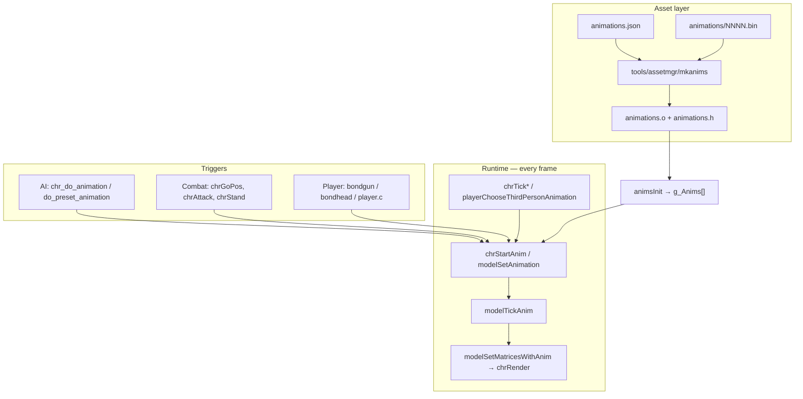

# Character animations — study guide

Step-by-step path from animation **data on disk** to **pixels on screen**, with a **test you can run** after each step.

Related docs: [`ANIMLAB_SPEC.md`](ANIMLAB_SPEC.md) (Anim Lab SDD requirements & acceptance), [`ailists.md`](ailists.md), [`chrs.md`](chrs.md), [`MAP_MAKING_WIKI.md`](MAP_MAKING_WIKI.md).

---

## Big picture



There are **1207** animations in NTSC Final (`ANIM_IDLE` … `ANIM_END-1`). The numeric index **is** the value passed to `modelSetAnimation` and `chr_do_animation`.

Lookup helper:

```bash
python3 tools/list_animations.py --search yawn
python3 tools/list_animations.py --id ANIM_SNEEZE
```

---

## Step 1 — Animation assets and IDs

**What:** Each animation is a header plus per-frame bone deltas packed in ROM (or mod files on PC).

| File | Role |
|------|------|
| `src/assets/<ROMID>/animations.json` | Catalog: id, frame count, binary filename, flags |
| `src/assets/<ROMID>/animations/NNNN.bin` | Raw animation bytes |
| `tools/assetmgr/mkanims` | Builds `animations.o` and generated `animations.h` enum |

**Key fields in JSON:**

- `numframes` — last frame index is `numframes - 1`
- `flag01` → `ANIMFLAG_ABSOLUTETRANSLATION` (movement baked into root; affects merge rules)
- `flag02` → repeat-frame compression in header

**Test 1 — verify catalog**

```bash
python3 tools/list_animations.py --id ANIM_TWO_GUN_HOLD
# Expect: index 1, 163 frames, file 0001.bin

python3 tools/list_animations.py --id ANIM_YAWN
# Expect: index 154, 285 frames

python3 tools/list_animations.py --index 0
# ANIM_IDLE — 0 frames (placeholder; do not play)
```

**Pass criteria:** Commands print sensible frame counts; index matches array order in `animations.json`.

---

## Step 2 — Loading and caching (`anim.c`)

**What:** At boot, `animsInit()` DMAs the animation **table** into `g_Anims[]`. Frame data is loaded on demand into fixed-size caches (`ANIM_FRAME_CACHE_SIZE = 32` headers, 32 frames).

Important APIs (`src/lib/anim.c`, `src/include/lib/anim.h`):

- `animGetNumFrames(animnum)` — frame count
- `animLoadHeader(animnum)` / `animLoadFrame(animnum, frame)` — populate caches before posing

On the **PC port**, if `mods/<moddir>/animations/NNNN.txt` + `NNNN.bin` exist, `modAnimationLoadDescriptor()` replaces the ROM table entry at runtime (`port/src/preprocess/misc.c`).

**Test 2 — confirm binary exists on disk**

```bash
ls -l src/assets/ntsc-final/animations/009a.bin   # ANIM_YAWN
ls -l src/assets/ntsc-final/animations/009f.bin   # ANIM_SNEEZE
```

**Pass criteria:** Files exist and are non-empty.

---

## Step 3 — Playing an animation on a model (`model.c`)

**What:** `modelSetAnimation(model, animnum, flip, startframe, speed, merge)` is the low-level “start playing” call.

| Parameter | Meaning |
|-----------|---------|
| `animnum` | Index into `g_Anims[]` / `ANIM_*` enum |
| `flip` | Mirror animation (used for left/right variants) |
| `startframe` | First frame (can be negative sentinel in some callers) |
| `speed` | Frames advanced per tick (sign = direction if reversed) |
| `merge` | Blend time from previous pose (0 = snap, 16 = typical smooth) |

Companion calls:

- `modelSetAnimEndFrame(model, endframe)` — stop early (`-1` = play all)
- `modelSetAnimLooping(model, loopframe, merge)` — loop from `loopframe`
- `modelSetAnimSpeed(model, speed, startframe)` — change speed mid-anim
- `modelGetCurAnimFrame` / `modelGetAnimNum` — introspection

Each frame, `modelTickAnim()` advances `anim->frame`, handles looping and merge (`animnum2`), then `modelSetMatricesWithAnim()` applies bone matrices for rendering.

**Test 3 — see a looped stand pose (simulant)**

Simulants use `chrChooseStandAnimation()` → `modelSetAnimation` with looping idle (e.g. `ANIM_TWO_GUN_HOLD` or `ANIM_006A`).

```bash
make -j8
./build/pd.arm64 --test-map --moddir mods/mod_allinone --num-sims 1
```

In Combat Simulator, pick **Counter-Op** or a mode where you can see the simulant body. The bot should idle in a weapon-hold loop.

**Pass criteria:** Simulant plays a subtle looping stand animation, not T-pose.

---

## Step 4 — Character action state (`chrStartAnim`)

**What:** NPCs don't call `modelSetAnimation` directly from AI in most cases. They go through `chrStartAnim()` which sets **`actiontype = ACT_ANIM`** and stores parameters in `chr->act_anim`:

```c
// src/game/chraction.c — chrStartAnim()
chr->actiontype = ACT_ANIM;
chr->act_anim.animnum = animnum;
chr->act_anim.pauseatend = (flags & CHRANIMFLAG_PAUSEATEND);
// … then modelSetAnimation(...)
```

Each frame, `chrTick()` dispatches `chrTickAnim()` for `ACT_ANIM`:

- Waits for merge to finish if `CHRHFLAG_NEEDANIM`
- When past end frame → `chrStand(chr)` (unless `CHRANIMFLAG_PAUSEATEND`)
- Special cases: sneeze SFX at frame 42, reload disarm at `ANIM_RELOAD_0209`

**CHRANIMFLAG_* (`constants.h`):**

| Flag | Effect |
|------|--------|
| `FLIP` (0x01) | Mirror |
| `MOVEWHENINVIS` (0x02) | Cutscene: move while off-screen |
| `PAUSEATEND` (0x04) | Hold last frame instead of standing |
| `COMPLETED` (0x08) | Mark anim as “done” for AI checks |
| `SLOWUPDATE` (0x10) | Throttle AI while playing |
| `LOCKPOS` (0x40) | Don't drift from root motion |
| `REVERSE` (0x80) | Negate speed |

**Test 4 — watch a scripted anim in a mission**

Load **Chicago (WAX)** — Cass NPC uses explicit anims:

1. `ANIM_TALKING_00A0` frames 0–193 (talk loop)
2. `ANIM_DRAW_PISTOL_0245` (draw weapon)

Reference: `src/setups/setupwax.c` around `func0411_cass_in_office`.

**Pass criteria:** In Villa, Cass plays talking anim until you enter LOS, then draw pistol anim before combat.

---

## Step 5 — AI command: `chr_do_animation`

**What:** AI bytecode command `0x000b` → `aiChrDoAnimation()` in `chraicommands.c`.

Macro (`commands.h`):

```c
chr_do_animation(animation, startframe, endframe, chranimflags, timemerge, chr, animspeed)
```

| Argument | Notes |
|----------|-------|
| `startframe` | `0xffff` → 0; `0xfffe` → **last** frame (cutscene sync trick) |
| `endframe` | `0xffff` → -1 (play to natural end) |
| `animspeed` | Divisor: `speed = 1.0f / animspeed` (2 → half speed) |
| `chr` | `CHR_SELF`, `CHR_BOND`, etc. |

Typical pattern from `setupwax.c`:

```c
chr_do_animation(ANIM_WALK_BACKWARDS, -1, -1, CHRANIMFLAG_SLOWUPDATE, 16, CHR_SELF, 2)
yield
beginloop(0x08)
    if_chr_stopped(/*goto*/ 0x06)   // waits until ACT_STAND / anim finished
endloop(0x08)
```

`if_chr_stopped` → `chrIsStopped()` — true when back in `ACT_STAND` (or special cases).

**Test 5 — isolate one anim via dev setup (optional lab)**

Copy the **Animation lab** snippet below into `src/setups/setupuff.c`, rebuild, and run Villa/UFF with the **compiled** setup (not pdmap-deployed setup — pdmap only emits ailist `0x1000` today).

**Pass criteria:** Guard cycles Yawn → Sneeze → Talk → repeat; `if_chr_stopped` gates each step.

---

## Computer / console interaction animations

Stock Perfect Dark already ships **10 chr animations** for terminals, consoles, and seated
desk work. They are **not new binary work** — missions use them via `chr_do_animation` while
the player activates `singlemonitor` / `multimonitor` props (`OBJFLAG3_INTERACTABLE`).

| Animation | Index | Parade slot | Role |
|-----------|------:|------------:|------|
| `ANIM_STAND_UP_FROM_SITTING` | 506 | 296 | Rise from chair after seated idle |
| `ANIM_SITTING_TYPING` | 507 | 297 | Seated keyboard / laptop loop (`abs-trans`) |
| `ANIM_OPERATE_0204` | 516 | 301 | Standing terminal operate (variant A) |
| `ANIM_OPERATE_0205` | 517 | 302 | Standing operate (variant B) — BioTech random pool |
| `ANIM_OPERATE_0206` | 518 | 303 | Standing operate (variant C) — e.g. Jonathan planting |
| `ANIM_OPERATE_0221` | 545 | 308 | Short console tap (A) — CI / LIP BioTech2 |
| `ANIM_OPERATE_0222` | 546 | 309 | Short console tap (B) |
| `ANIM_OPERATE_0223` | 547 | 310 | Console swipe — often with `CHRANIMFLAG_FLIP` |
| `ANIM_SITTING_DORMANT` | 551 | 312 | Seated desk idle — RIT pilots, guard rooms |
| `ANIM_SITTING_0265` | 613 | 334 | Alt seated idle — CAVE / DISH |

**Where missions use them**

- **Standing operate (0204–0206):** Transportation hangar terminals, Dam/Pelagic II
  destructibles, Area 51 Escape, Pelagic II (`setuppam`, `setupdam`, `setupark`). Guards
  pick randomly among the three (`call_rng` → `chr_do_animation`).
- **Short console (0221–0223):** Carrington Institute BioTech (`setuplip` func0430/0431),
  Air Base cyclone guards (`setuprit`), Lee hangar (`setuplee`).
- **Seated (typing / dormant / 0265):** RIT Air Base pilots at desks (`setuprit`
  func0411/0412), ELD lab typing (`setupeld`), CAVE/DISH guard rooms.

**Props vs chr anims:** Console **screen flicker** uses object anims such as `ANIM_025A`
(`object_do_animation` on pad `0xff` in CAVE/LIP) — that is prop motion, not a guard pose.
Guards do not need a desk prop to **play** the chr anims in animlab; in missions, alignment
to `MODEL_PD_CONSOLE` / `MODEL_SINISTERSTATION` pads is setup-authored.

### See them in Animation Lab

1. **Full catalog filter:** Animation Lab app → **Full catalog** tab → chip **💻 Computer / console**.
2. **Parade grid:** Build animlab, walk north — computer anims use **cyan floor markers**
   (category `computer` in `tools/pdmap/anim_catalog.py`). Slots listed above (~296–334).
3. **Full-tour cycler:** Pad **571** at (x≈700, z≈−1500) cycles all 570 named anims including
   every operate/typing clip in ROM index order.

```bash
python3 tools/list_animations.py --search operate
python3 tools/list_animations.py --id ANIM_SITTING_TYPING
python3 tools/pdmap.py build animlab --seg --deploy
./build/pd.arm64 --test-animlab --moddir mods/mod_allinone --solo --num-sims 0
```

### What you cannot get without new binary work

| Want | Stock ROM? | Notes |
|------|------------|-------|
| Mouse/trackball-specific gestures | No | Only generic tap/swipe/typing loops |
| Per-console unique anims (e.g. WAX dataDyne hub) | Partial | Same chr anims on all interactable monitors |
| Typing with visible keyboard prop in chr hands | No | Seated typing is body-only; desk is level geo |
| New “hack progress bar” body language | No | Requires new `.bin` + `animations.json` (Step 10) |

For PC experiments, clone layout from `ANIM_SITTING_TYPING` or `ANIM_OPERATE_0204` and
override via `mods/.../animations/` (Step 9). Full new names need `mkanims` rebuild.

---

## Step 6 — Preset talking / gun-jam anims

**What:** `do_preset_animation(PRESETANIM_*)` → `aiDoPresetAnimation()` maps presets to concrete `ANIM_*` values (talking variants, `ANIM_FIX_GUN_JAM_EASY/HARD`).

**Test 6 — Villa intro guards**

Play Chicago intro; guards use `PRESETANIM_TALKRANDOM` in `setupwax.c`.

**Pass criteria:** Random talking gesture from the preset table before combat starts.

---

## Step 7 — Automatic combat / movement anims

**What:** Most gameplay anims are **not** ailist-driven. The chr action tickers pick anims from context:

| Action | Chooser | Example anims |
|--------|---------|---------------|
| `ACT_STAND` | `chrChooseStandAnimation` | `ANIM_TWO_GUN_HOLD`, `ANIM_006A` |
| `ACT_GOPOS` | `chrGoPosChooseAnimation` | walk/run by weapon weight + `GOPOSFLAG_*` |
| `ACT_ATTACK` | `chrAttackChooseAnimation` | kneel/stand fire |
| `ACT_DIE` | death picker | `g_DeathAnimations[]` |
| Hit react | `func0f031254` area | `ANIM_01F8`, `ANIM_01F9` by hit bone |

**Test 7 — simulant combat in UFF arena**

```bash
python3 tools/pdmap.py build uff --seg --deploy
./build/pd.arm64 --test-map --moddir mods/mod_allinone --num-sims 4
```

**Pass criteria:** Bots walk/run with weapon-appropriate cycles; on death, play death anim then corpse state.

---

## Step 8 — Player animations (first / third person)

**What:** Player body uses the same `model`/`anim` system but different drivers:

| Layer | Driver | Example |
|-------|--------|---------|
| Third-person body | `playerChooseThirdPersonAnimation()` | movement, death |
| FP arms / gun | `bgunStartAnimation()` via weapon `fire_animation` | trigger squeeze |
| Head | `bondhead.c` | `g_HeadAnims[]`, resting vs moving |

Reload, switch, and fire timings live in weapon functions (`bondgun.c` → `bgunTickIncAttackEmpty` checks `func->fire_animation`).

**Test 8 — FP trigger anim**

```bash
./build/pd.arm64 --test-map --moddir mods/mod_allinone
```

Pick Falcon 2 or MagSec, fire until empty. Pistols with finger anims restart every 25 ticks (`bondgun.c`).

**Pass criteria:** Visible finger/trigger motion on empty click; rifle-class weapons still click without finger anim.

---

## Step 9 — Modify an existing animation (PC mod)

**What:** Replace ROM data without recompiling `animations.o`:

1. Create `mods/mod_allinone/animations/009a.txt` (descriptor override):

   ```
   numframes 285
   bytesperframe 47
   headerlen <same as stock or from experiment>
   framelen 12
   flags 0
   ```

2. Place modified `mods/mod_allinone/animations/009a.bin` (full anim binary — header + frames).

At load, `preprocessAnimations()` swaps the table entry and sets `data = 0xffffffff`; `anim.c` loads bytes via `modAnimationLoadData()`.

**Test 9 — safe experiment**

1. Backup: `cp src/assets/ntsc-final/animations/009a.bin /tmp/009a.bin.bak`
2. Copy stock to mod: `mkdir -p mods/mod_allinone/animations && cp src/assets/ntsc-final/animations/009a.bin mods/mod_allinone/animations/009a.bin`
3. Add minimal `009a.txt` with matching `numframes` / `bytesperframe` from `list_animations.py`
4. Trigger yawn via Step 5 lab or WAX Cass idle variant

**Pass criteria:** Game loads with log `mod: loaded external animation 009a`; yawn still plays (identical copy). Then edit binary and confirm visible change.

> **Warning:** Wrong `bytesperframe` / `headerlen` causes garbage poses or crashes. Always match descriptor to binary layout.

---

## Step 10 — Add a brand-new animation slot

**What:** Requires rebuilding assets:

1. Append entry to `src/assets/<ROMID>/animations.json` (new `id`, `file`, frame stats)
2. Add `animations/XXXX.bin` (format matches existing entries — typically cloned from similar anim)
3. Rebuild: `make -j8` (runs `mkanims` → new `ANIM_YOURNAME` in generated header)
4. Reference `ANIM_YOURNAME` in setup or C code

For **PC-only** experiments without full rebuild, you can override an **unused** low-traffic index via mod descriptor + binary (Step 9) and reference that index number in ailist until enum is regenerated.

**Test 10 — checklist**

- [ ] JSON entry added; `mkanims` succeeds
- [ ] `python3 tools/list_animations.py --id ANIM_YOURNAME` shows new index
- [ ] `chr_do_animation(ANIM_YOURNAME, …)` in a test ailist plays without T-pose
- [ ] Frame count in descriptor matches binary

---

## Animation lab map (category districts)

### Master zone plan

**Start here:** [`ANIMLAB_VISION.md`](ANIMLAB_VISION.md) — mission, zone map, content accounting, and success picture.

**Canonical organization contract:** [`ANIMLAB_MASTER_PLAN.md`](ANIMLAB_MASTER_PLAN.md) — eight compass zones, room budget, navigation palette, phased roadmap, and success criteria. Update that doc when moving wings or changing counts.

**Current build (2026):** **170** guard-playable animation slots in **9** districts / **12** sub-zones (rooms **2–13**). **570** named ROM anims exist; **400** are excluded by ``parade_guard_playable()`` (CUT_*, cinematic flags, Skedar/bike rigs). Target **571** grid slots is a Phase 4 goal (alternate bodies for cutscene district).

**South hub (room 1):** spawn pad **0** at **(0, −2200)**. **Eight** compass portals at **800 u** radius. **Full-tour cycler** pad **171** at **(600, −2200)**. Walk **N** for animation districts; **SW** props gallery; **W** object catalog; **NW** true scale (normal + mega yards); **SE** characters; **WSW / E / NE** level worlds.

**Props gallery** **(−2200, −3000)** · **Object catalog** hub **(−21000, −26500)** — 352 models, 7 tag districts · **True-scale yard** normal **(15000, −20000)** / mega **(−29000, −29000)**. Filter wings in the Parade tab; toggle map layers for walk paths, vignettes, catalog, and level bounds.

**Interaction registry:** ``tools/pdmap/anim_interactions.py`` maps each district to prop model IDs and representative chr anim ids (computer OPERATE_*, combat cover, etc.). Slots in the UI show ``interactionContext`` and linked prop pad numbers.

**Map Editor 3D preview:** Start Anim Lab server, open Map Editor → **Import Anim Lab layout (overlay)** (or ``?import=animlab``). Fetches ``GET /api/preview-geometry`` from port 8776+. Read-only overlay — edit layout via pdmap Python sources.

### District grid (north of corridor)

| District | Category | Anims | Sub-zones | Centre (x, z) |
|----------|----------|-------|-----------|---------------|
| Row 0 | movement · social · combat · react | 4 · 12 · 11 · 9 | 1 each | (−2250,−900) … (2250,−900) |
| Row 1 | death · computer · use · other | 14 · 10 · 4 · 11 | 1 each | (−2250,300) … (2250,300) |
| Row 2 | weapon | 103 | 4 (2×2) | (−1500, 1500) |
| Row 3–4 | cutscene | **0** parade / **392** ROM | reserved (Phase 4) | (0, 3300) |

District boundaries use **category-coloured carpet tiles** on the hub floor plus **per-cell
markers in each sub-zone tile room** (rooms 2–27). Labels live in the Animation Lab app
(top-down arena map + slot grid).

### Props placed (``tools/pdmap/anim_props.py``)

| Layer | Pads | Count | Notes |
|-------|------|-------|-------|
| Furniture gallery | 172–179 | 8 | 3×3 grid SW of spawn (open center) — cyan carpet |
| North walk computer | 180–183 | 4 | Desk/console/chair/table **flanking** corridor (spine clear) |
| District vignettes | 184–199 | 16 | Category entrance props offset to district sides |
| Prop museum (object catalog) | 200+ | 352 | 7 tag districts — showcase-scaled; rooms 14–15, 20–24 |
| Hub signposts | — | 7 | Compass ring at spawn (~440 u radius) |
| True scale gallery | 559+ | 352 | Retail extrascale only — actual bbox dimensions (two wings) |

**Where to find props in-game**

1. **Spawn plaza:** You land at **(0, −2200)** facing north. The plaza is **open** — no solid
   props within **500 u** so you can move freely. Walk **southwest** to the cyan **furniture
   gallery** centred at **(−2200, −3000)** (desks, chair, console, crates in a spaced 3×3 grid
   with a walk-through alcove in the middle).
2. **Signpost ring:** Seven labelled crate signposts at the spawn plaza edge point to each wing
   (N districts, SW props/catalog, E true scale, NW mega yard, SE characters, NE megaworld).
3. **Walk north:** Four **computer** props flank the corridor at **x ≈ ±380** (desk, console,
   chair, table) — the **centre spine stays clear** for movement toward districts.
4. **District mouths:** Vignette props sit **to the sides** of each category entrance, not on
   the walk path. The **computer district** mouth (row 1, centre **x ≈ −750, z ≈ −300**) has
   desk + chair + console offset laterally.
5. **Walk southwest:** Follow the catalog spine from spawn → props gallery → object catalog
   megazone (~**21 000 u** southwest). **352** StdObjects in **7 tag districts** (showcase-scaled).
6. **Walk east-north:** **True-scale gallery** teal carpet centred at **(15000, −20000)** — normal
   objects at retail bbox size. Megastructures in far NW yard at **(−29000, −29000)**.
7. **Walk southeast:** Purple **character gallery** at **(5500, −4500)**.
8. **Walk northeast:** Orange **level megaworld** archipelago from entry gate **(5500, 3000)**.

Furniture gallery (pads 172–179) — **480 u** pitch, centre **(−2000, −2850)**:

| Label | Model ID | Approx. world (x, z) |
|-------|----------|----------------------|
| Door console | `0x0018` | (−2480, −3330) |
| Lab mainframe | `0x00BE` | (−2000, −3330) |
| CI desk | `0x0161` | (−1520, −3330) |
| A51 crate A | `0x0020` | (−2480, −2850) |
| *(open alcove)* | — | (−2000, −2850) walk-through |
| A51 crate B | `0x0021` | (−1520, −2850) |
| A51 desk + terminal | `0x0066` | (−2480, −2370) |
| Lab table | `0x00BC` | (−2000, −2370) |
| Lab chair | `0x00BB` | (−1520, −2370) |

**StdObject flags:** ``OBJFLAG2_NOFALL`` (`0x00000100`) + extrascale ``0x0100`` (1.0× — retail
furniture default; runtime uses ``extrascale / 256`` in ``setupCreateObject``). Per-model
extrascale comes from retail ``setup*.c`` ``stdobject(scale, MODEL_*, …)`` lines (most frequent
placement wins); models without retail placements default to ``0x0100``. Applied to gallery,
corridor, vignettes, and museum via ``stdobject_models.json``.
All props use **room 1** (``STAGE_ANIMLAB`` draw bypasses).

**Museum catalog:** ``tools/pdmap/gen_model_catalog.py`` → ``tools/pdmap/data/stdobject_models.json``
(includes ``scale`` / ``scaleHex`` / ``scaleSource`` and per-model ``width`` / ``depth`` /
``halfX`` / ``halfZ`` from ``MODELNODETYPE_BBOX`` rodata in ``src/assets/ntsc-final/files/props/*.bin``
at extrascale ``0x0100``). Regenerate after ``constants.h`` changes. Cap via
``ANIMLAB_MUSEUM_MAX`` — **``0`` (default) = full catalog**; set a positive integer to limit
(round-robin by tag). Layout: **tag-district packing** (``tools/pdmap/museum_layout.py`` →
``pack_tag_districts()``) — each ``stdobject_models.json`` tag gets its own compass cluster
around hub **(−21000, −26500)** with dimension-packed rows per tag. Arena seg half capped at
**32000 u** (s16 vertex limit). ``ANIMLAB_DRAW_DIST`` **48000 u**. Default ``ANIMLAB_PARADE_MAX=570``.
Seg mode **``parade_districts``** — districts + props + object catalog + true-scale + characters + megaworld + signposts.

### Object catalog tag districts (showcase scale)

| Tag | Count | Room | Carpet | Compass from hub |
|-----|-------|------|--------|------------------|
| misc | 133 | 24 | ``#64748b`` | centre (hub) |
| architecture | 70 | 21 | ``#a78bfa`` | north |
| skedar | 51 | 23 | ``#ef4444`` | east |
| military | 35 | 15 | ``#94a3b8`` | west |
| furniture | 28 | 14 | ``#eab308`` | south |
| lab | 25 | 20 | ``#22d3ee`` | northwest |
| ci | 10 | 22 | ``#f472b6`` | northeast |

### Wing map (from spawn pad 0)

| Wing | Direction | Centre / entry | Carpet | Find it |
|------|-----------|----------------|--------|---------|
| Animation districts | N | z≈−900 grid | per-category | Signpost **N** · walk north spine |
| Props gallery | SW | (−2200, −3000) | cyan | Signpost **SW** · first stop southwest |
| Object catalog | WSW | hub (−21000, −26500) | tag colours | Signpost **WSW** · past props gallery |
| True scale (normal) | E | (15000, −20000) | teal | Signpost **E** · east-north corridor |
| True scale (mega) | NW | (−29000, −29000) | dark teal | Signpost **NW** · far northwest |
| Character gallery | SE | (5500, −4500) | purple | Signpost **SE** · southeast approach |
| Level megaworld | NE | gate (5500, 3000) | orange | Signpost **NE** · orange archipelago |
| Full tour | E | (600, −2200) | gold | East of spawn plaza |

### True-scale gallery (actual size — no showcase shrink)

Parallel third prop section: every placable StdObject at **retail extrascale only** (via
``_prop_scale_for_model`` / ``stdobject_models.json``). Placement spacing uses **actual bbox
half-extents** from ``MODELNODETYPE_BBOX`` rodata in ``src/assets/ntsc-final/files/props/*.bin``
— **not** tag heuristics or ``PARADE_MUSEUM_SHOWCASE_MAX_HALF`` shrink.

| Wing | Centre | Count | Carpet | Notes |
|------|--------|-------|--------|-------|
| Normal objects | **(15000, −20000)** | 163 | ``#14b8a6`` teal | peak bbox half ≤ 450 u |
| Megastructure yard | **(−29000, −29000)** | 189 | ``#0d9488`` dark teal | peak bbox half > 450 u; s16-safe anchor |

**Layout:** ``tools/pdmap/museum_layout.py`` → ``pack_true_scale_rows()``; specs in
``tools/pdmap/anim_props.py`` (``kind="true_scale"``). Combined **352** models —
``verify_museum_placements()`` reports **0** AABB overlaps vs showcase museum and between wings.

**Largest true-scale footprints (peak half-extent, retail scale):**

| Model | Peak half (u) | Label |
|-------|---------------|-------|
| ``0x012A`` | 15000 | A51 radar console |
| ``0x0135`` | 10719 | Baggage carrier |
| ``0x005B`` | 8396 | Dropship |
| ``0x00D1`` | 7515 | Skedar floor shadow (T) |
| ``0x00D6`` | 7515 | Skedar floor no-shadow (T) |

Megastructure yard carpet is **s16-clamped** (``carpetHalf`` ≈ 1200 u) — props extend far beyond
walkable tiles but load without crash. ``ANIMLAB_DRAW_DIST`` is **48000 u** (``env.c`` z-far matches)
so megaworld, museum, true-scale mega yard, and character gallery all render from the south hub.

Character gallery pads follow **after** all props (showcase museum + true scale) — typically **903+**
with default catalog caps.

### Character gallery (main story bodies)

Separate southeast wing from the animation parade (which uses ``BODY_AREA51GUARD`` for every
loop). **24** mannequins on retail ``BODY_*`` / ``HEAD_*`` rigs — Joanna outfits, allies,
villains, and faction guards — defined in ``tools/pdmap/anim_characters.py``
(``MAIN_CHARACTER_ENTRIES``).

| Constant | Value |
|----------|-------|
| Centre | **(5500, −4500)** |
| Half (carpet) | **950 u** |
| Grid | **6×4** @ **380 u** pitch |
| Room | **1** (hub visibility) |
| Floor colour | ``#c084fc`` (purple) |
| Chr slots | ``CHR_SPECIAL_TOUR + 1`` … (``0xFB``+ with default parade cap) |
| Pads | After all StdObject props (typically **903+** with full catalog) |
| Idle anim | ``ANIM_TWO_GUN_HOLD`` (index **1**) loop per chr |

Walk **east/southeast** from spawn along the purple carpet (east approach corridor). UI:
Animation Lab **Parade** tab → **Character gallery** district chip; spatial layer toggle
**Characters**.

Groups: ``joanna`` (6 outfits), ``allies`` (8), ``villains`` (6), ``guards`` (4).
Skedar / Skedar King / guard bodies use ``HEAD_RANDOM`` (``0xFFFF``) like retail setups.

### Level worlds (solo campaign + Combat Simulator + dev annex)

Three disjoint walkable districts from ``tools/pdmap/anim_levels.py`` — every row in
``src/game/stagetable.c`` except ``STAGE_ANIMLAB`` gets one labelled floor island plus
a scaled A51 crate sign prop (museum-style flags — no geo alloc).

| World | Compass | Gate | Grid origin | Count | Carpet |
|-------|---------|------|-------------|-------|--------|
| Solo Campaign | WSW | **(−4200, −5200)** | **(−15800, −8800)** | **23** story missions | gold ``#f59e0b`` |
| Combat Simulator | E | **(9200, −2800)** | **(21800, −3200)** | **26** MP maps (incl. ``STAGE_TEST_MP*``) | crimson ``#dc2626`` |
| Dev & extras | NE | **(5200, 3600)** | **(15200, 11800)** | **40** test / GEX / mod / internal | slate ``#64748b`` |

| Constant | Value |
|----------|-------|
| Grid pitch | **1050 u** (solo/MP), **1000 u** (dev) |
| Island half | **260–340 u** by category (larger than prior megaworld) |
| Bridge width | **400 u** (``MEGAWORLD_BRIDGE_HALF_WIDTH = 200``) |
| Room (island props) | **18** (``PARADE_MEGAWORLD_ROOM`` — 89 props < 200/room limit) |
| Hub carpets | Room **1** — colour-coded spines from spawn to each gate |
| Pads | After character gallery (typically **575+**) |

**Graph:** per-world Hamiltonian serpentine path in ``g_Stages[]`` order within each district;
400 u hub spines from spawn **(0, −2200)** to each gate; intra-world L-bridges between
consecutive islands.

**Solo coverage:** all retail story missions including ``STAGE_EXTRACTION`` (reclassified from
GEX extras). **MP coverage:** all ``STAGE_MP_*`` plus dev Combat Simulator arenas
``STAGE_TEST_MP2`` … ``STAGE_TEST_MP20``.

**Portal / warp:** **not implemented** — islands are catalog markers only. Extension point:
``add_level_megaworld_pads`` + future ailist ``lv`` triggers per ``STAGE_*`` hex.

Walk from spawn: **WSW** gold → Solo world; **east** crimson → MP world; **NE** slate → dev
annex. UI: Parade tab → **Solo world** / **MP world** / **Dev annex** chips; spatial layer
**Levels** shows three coloured world bounds.

### Engine limit (why sub-zones)

``cdCollectGeoForCyl`` (``src/lib/collision.c``) allocates ``s16 propnums[256]`` and
calls ``roomGetProps(rooms, propnums, 256)``. ``roomGetProps`` does **not** clamp writes
to *len* — spawning 571 guards in one room overflows the stack during ``bodyAllocateChr``
→ ``cdTestVolume``. Keep **≤30–40 chr props per tile room**; animlab uses
``PARADE_MAX_CHR_PER_ZONE = 30`` in ``tools/pdmap/anim_catalog.py``.

**Render path:** Lab guards get ``CHRCFLAG_NOSHADOW`` at spawn (``body.c``) and via
ailist ``set_self_chrflag``. ``chrRender`` must **skip** ``gfxRenderRadialShadow`` when
that flag is set — zero alpha still calls ``texSelect`` and exhausts the texture pool
when 500+ chr draw on the first frame. ``STAGE_ANIMLAB`` also skips radial shadows in
``chr.c`` as a belt-and-suspenders guard.

**Multi-room visibility (PC port):** Guards use tile rooms 2+ for collision, but the
player stays in room 1. ``camIsPosInFovAndVisibleRoom`` falls back to the **camera room
draw slot** on ``STAGE_ANIMLAB`` when prop rooms lack ``ROOMFLAG_ONSCREEN``.
``func0f08e8ac`` / ``propsTick`` also use draw-distance bypasses so district grids and
props render when you walk north.

**On-screen prop sort (PC port):** ``propsSort`` (``prop.c``) must handle every guard and
StdObject marked on-screen. The stock N64 build used a **200-entry** ``onscreenprops`` heap
buffer and a **201-element** stack ``depths[]`` array — both overflow with 600+ parade
entities. PC port allocates ``onscreenprops`` to ``maxprops + 1`` and sorts by ``prop->z``
with no fixed stack buffer.

**GDL guard (PC port):** ``propsRender`` reserves **16 KB** on ``STAGE_ANIMLAB``. When the
buffer runs low after distant chr draws, the port **skips chr props but still draws
PROPTYPE_OBJ** scenery so spawn-plaza StdObjects remain visible.

**On-screen list (PC port):** ``propsSort`` collects **PROPTYPE_OBJ first** on ``STAGE_ANIMLAB``
so parade chr cannot fill ``g_Vars.onscreenprops`` before plaza/hub StdObjects. ``objTickPlayer``
falls back to draw-distance visibility when FOV/room culling would hide room-1 scenery.

**Build & Play:** ``serve_animlab.py`` redeploys the map to **`mods/mod_allinone` only**
(``--mod mod_allinone``) and **rebuilds ``pd.arm64``** when engine sources are newer than
the binary. Launch always uses ``--moddir mods/mod_allinone``.

Zone layout is computed from the usable named catalog (``parade_usable_rows()`` — non-stub
names with ``numframes > 0``; ``parade_zone_count()``, ``parade_grid_dims()`` per zone).

The Animation Lab app **Parade** tab lists every slot with **district filters**, sub-zone
chips (for multi-zone districts), index, memory hint, study step, and guard chr / pad,
plus an interactive floor map, props district view, and the full-tour cell.

### In-engine “text markers” (what pdmap can emit)

| Mechanism | pdmap class | In-world labels? |
|-----------|-------------|------------------|
| Seg/tile floor markers | `floor_box_with_parade_slots` / CTF/KOTH helpers | **Colour only** — no arbitrary strings |
| `RenameObject` (0x25) | `RenameObject` | Pickup/HUD strings via `L_*` lang IDs only |
| `BeginObjective` / `Briefing` | `BeginObjective`, `Briefing` | Mission objective HUD, not world billboards |
| `SingleMonitor` / `MultiMonitor` | `SingleMonitor`, `MultiMonitor` | Pre-baked ROM screen images (`imagenum`), not runtime text |

For animlab, **coloured floor squares + Animation Lab UI** is the practical labelling approach.

### Build and play

```bash
python3 tools/pdmap.py build animlab --seg --deploy
make -j8   # once, after first `pdmap register animlab --apply`
./build/pd.arm64 --test-animlab --moddir mods/mod_allinone --solo --num-sims 0
```

Walk north from spawn (pad 0 at z≈−2200). Full-tour cycler pad **171** at (600, −2200).
Props gallery **SW** (pads **172+**, room 1 hub props). Character gallery **SE** (pads **907+**,
purple carpet at **5500, −4500**). District row 0 centres z≈−900; weapon z≈1500 — **12 sub-zones**,
arena ±**32000** u. See [`ANIMLAB_MASTER_PLAN.md`](ANIMLAB_MASTER_PLAN.md) for the full zone map.

### Layout alternatives (why grid)

| Layout | Pros | Cons |
|--------|------|------|
| **North line (old)** | All visible in one pan | Extreme span; hard to read individual anims |
| **ROM-order zones (old)** | ≤30 guards/room | Categories interleaved — hard to browse |
| **Category districts (current)** | Grouped by combat/computer/death/…; props district | Large arena (±8k u); cutscene = 14 sub-zones |
| **Compact single grid (old)** | All visible in one pan | **571 chrs in room 1 → stack overflow crash** |
| Single chr cycling | Minimal setup | Only one anim at a time — poor showcase |
| **Districts + full-tour + props (current)** | Static loops per category + sequential demo + scenery | Large setup; many chrs |

**Recommendation for this repo:** **category districts** with **per-slot loops** in
**sub-zoned grids** (≤30/room) for the full named catalog, a **full-tour cycler** in
room 1, and a **props district** for computer/combat context.

### Animation Lab app (Electron)

One-click build, play, catalog search, and uff restore:

```bash
# Dev (from repo root)
cd journal/anim_lab/electron && PD_REPO_ROOT="$(cd ../../.. && pwd)" npm start

# Or browser-only (no Electron)
python3 journal/anim_lab/serve_animlab.py

# Packaged macOS .app
./scripts/build-anim-lab-electron.sh
```

Opens **Perfect Dark Animation Lab** — **Build & Play Anim Lab** deploys to
`mods/mod_allinone` (`bg_animlab.*`, `Ump_setupanimlabZ`) and launches with
`--test-animlab --moddir mods/mod_allinone` (`STAGE_ANIMLAB`). **UFF Arena**
uses its own `bg_uff.*` slot via `--test-map`; the two maps no longer overwrite each other.

Source: `journal/anim_lab/` (UI + `serve_animlab.py` API on port 8776+), `src/levels/animlab.py` (`STAGE_ANIMLAB` 0x82), setup packer `tools/pdmap/anim_parade.py`.

### Add or reorder showcase animations

The in-game grid is **automatic**: every named animation with ``numframes > 0`` (non-``ANIM_XXXX`` stub) from ``animations.json`` gets one grid slot, sorted by ROM index. No manual ``parade`` slot assignment required.

1. Optional: enrich labels in ``CURATED`` in ``tools/pdmap/anim_catalog.py`` (UI hints only).
2. Rebuild: ``python3 tools/pdmap.py build animlab --seg --deploy --mod mod_allinone`` (default ``ANIMLAB_PARADE_MAX=570`` — full named catalog; override with env for smaller smoke builds)

``anim_parade.SHOWCASE_ANIMS``, tour cycler, grid layout (``parade_grid_dims``, spacing, pads), and arena half derive from the catalog automatically.

**Included set:** guard-playable named entries only — excludes ``CUT_*`` cutscene/camera/dropship/vehicle
clips, ``flag08`` cinematic skip anims, and Skedar/bike-specific rigs (they use absolute world
translation and smear geometry when forced onto a pad-locked guard). Stub hex names and zero-frame
sentinels are also omitted. Typical count ≈**170** gameplay clips (override cap with ``ANIMLAB_PARADE_MAX``).

**Engine limit (phased sub-zones):** The PC/N64 engine cannot safely hold 500+ guards in
one tile room. Animlab splits the catalog into **category districts** with **12 sub-zones**
(≤30 guards per tile room; rooms 2–13) plus room 1 for hub, tour cycler, and props gallery.
Filter by district in the app;
walk north from the south hub to browse.

**PC port memory:** Set ``Game.MemorySize`` in ``pd.ini`` to **256** or higher (MB) so all 571 chr model instances can allocate during load. The default **16** MB is enough to verify the zone fix (no stack overflow / SIGSEGV) but not to spawn the full parade.

---

## Animation lab snippet (legacy — use animlab level instead)

Add to `src/setups/setupuff.c` (requires `make -j8`; do **not** deploy pdmap setup over this if testing the lab):

```c
#define CHR_ANIM_LAB 0x50
#define AILIST_ANIM_LAB 0x0401

// In props[] — stationary guard on pad 0x000F, never alerts:
chr(SPAWNFLAG_BASICGUARD, CHR_ANIM_LAB, PAD_UFF_000F, BODY_AREA51GUARD,
    HEAD_RANDOM, AILIST_ANIM_LAB, -1, -1, 1000, 100,
    CHRFLAG0_SKIPSAFETYCHECKS | CHRFLAG0_HOLD_POSITION,
    0, TEAM_ENEMY, SQUADRON_01, -1, 0, 0, 0, 0, 0)

u8 func0401_anim_lab[] = {
	set_self_chrflag(CHRCFLAG_NEVERSLEEP)

	label(0x10)
	chr_do_animation(ANIM_YAWN, 0, -1, CHRANIMFLAG_SLOWUPDATE, 16, CHR_SELF, 2)
	beginloop(0x11)
		if_chr_stopped(/*goto*/ 0x12)
		yield
	endloop(0x11)

	label(0x12)
	chr_do_animation(ANIM_SNEEZE, 0, -1, CHRANIMFLAG_SLOWUPDATE, 16, CHR_SELF, 2)
	beginloop(0x13)
		if_chr_stopped(/*goto*/ 0x14)
		yield
	endloop(0x13)

	label(0x14)
	do_preset_animation(PRESETANIM_TALK1)
	beginloop(0x15)
		if_chr_stopped(/*goto*/ 0x10)
		yield
	endloop(0x15)
};

// In ailists[]:
{ func0401_anim_lab, AILIST_ANIM_LAB },
```

Run:

```bash
make -j8
./build/pd.arm64 --test-map --moddir mods/mod_allinone --solo
```

Spawn at any pad; walk to pad `0x000F` — guard cycles yawn → sneeze → talk.

---

## Quick reference — which API when?

| Goal | Use |
|------|-----|
| Script NPC gesture | `chr_do_animation` in ailist |
| Script cutscene prop | `object_do_animation` |
| Talk / jam preset | `do_preset_animation` |
| C code forced anim | `chrStartAnim` / `chrTryStartAnim` |
| Direct model (no chr AI) | `modelSetAnimation` |
| Replace bytes (PC) | `mods/.../animations/NNNN.bin` + `.txt` |
| New enum name | Edit `animations.json` + rebuild |

---

## External animation sources (retargeting)

Perfect Dark does **not** ingest FBX, BVH, or glTF directly. External mocap must be
**retargeted to a PD skeleton**, then **encoded** into the Rare bit-packed `.bin`
format (header + per-frame deltas). See `animGetRotTranslateScale()` in
`src/lib/anim.c` for the on-disk layout.

### Recommended open sources (license-checked)

| Source | URL | Format | License (summary) |
|--------|-----|--------|-------------------|
| **Mixamo** | [mixamo.com](https://www.mixamo.com) | FBX (with/without skin) | Free commercial use via Adobe; do not redistribute raw files |
| **CMU Graphics Lab mocap** | [mocap.cs.cmu.edu](http://mocap.cs.cmu.edu) | ASF/AMC; BVH via [cgspeed.com](http://www.cgspeed.com) | Free research/commercial; acknowledge CMU; no reselling data |
| **Quaternius Universal Animation Library** | [opengameart.org/content/universal-animation-library](https://opengameart.org/content/universal-animation-library) | FBX / GLB | CC0 — 45 free clips; full library on [quaternius.com](https://quaternius.com) |
| **Motifect Locomotion Pack** | [motifect.itch.io/motifect-locomotion-motion-pack](https://motifect.itch.io/motifect-locomotion-motion-pack) | FBX + BVH | Free personal/commercial (animation data only) |
| **MoCap Online free pack** | [mocaponline.com](https://mocaponline.com) | FBX | Free tier; check current license before ship |

Retarget in **Blender** (Rokoko/AccuRIG for auto-rigging source meshes; Blender
NLA + Copy Rotation constraints for bone mapping). The PD target rig must match
the in-game skeleton (`g_SkelBasic` = 21 parts, `g_Skel0A`/`g_SkelChr` = 15–18
with left/right flip pairs — see `src/game/modeldata/*.c`).

### Realistic pipeline for this repo

```text
Open FBX/BVH  →  Blender retarget to PD rig  →  [missing: pd-anim-encode]
  →  animations/NNNN.bin + descriptor  →  mod override or animations.json + mkanims
```

1. **Fast experiment (PC):** override an unused or low-traffic slot via
   `mods/<moddir>/animations/NNNN.txt` + `NNNN.bin` (Step 9 above). ~262 catalog
   entries have `numframes: 0` and are safe placeholders until encoded.
2. **Ship new `ANIM_*` name:** append `animations.json`, add `.bin`, `make -j8`
   (Step 10).
3. **N64 ROM / Perfect Editor path:** community workflow exports PD models as
   DAE/FBX from Perfect Editor, animates in Blender, re-imports FBX animation —
   parallel to decomp assets, not wired into `mkanims` today.

### Tooling gap (not in repo yet)

| Have | Need |
|------|------|
| `tools/assetmgr/mkanims` (pack bins → ROM) | **Encoder**: keyed poses → PD header + bit-packed frames |
| `tools/list_animations.py` (lookup) | **Decoder** / inspector for `.bin` headers and part lists |
| `src/lib/anim.c` (runtime decode) | Part-index → bone-name map for `g_SkelBasic` / guard bodies |
| PC mod descriptors (`port/src/mod.c`) | Blender export script targeting a cloned similar anim's layout |

Clone layout from a **similar** stock anim (same skeleton, similar motion): match
`bytesperframe`, `headerlen` (`unk08` in JSON), and `framelen` (`unk0a`, usually 12).

---

## File index

| Path | Purpose |
|------|---------|
| `src/lib/anim.c` | Load/cache animation data |
| `src/lib/model.c` | Play, tick, merge, loop |
| `src/game/chraction.c` | `chrStartAnim`, action tickers, stand/walk/die |
| `src/game/chraicommands.c` | AI command handlers |
| `src/include/commands.h` | AI macros |
| `src/game/player.c` | Third-person player anims |
| `src/game/bondgun.c` | First-person weapon anims |
| `tools/list_animations.py` | ID / index lookup |
| `tools/assetmgr/mkanims` | Asset build |
