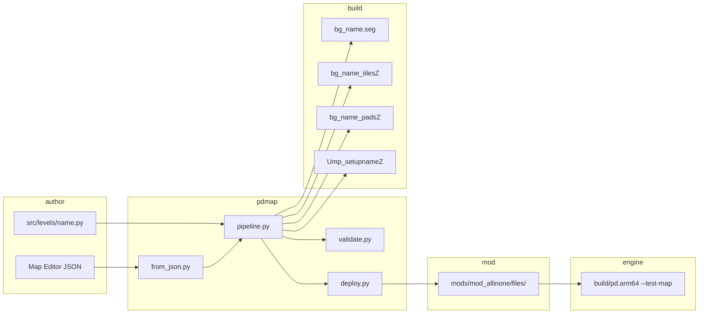

# Spec: Map Creation (normative)

**Spec IDs:** `R-MAP-01` … `R-MAP-58` in [`SPEC.md`](../../SPEC.md)  
**Generated invariants (do not hand-edit):** [`../MAP_DETERMINISTIC_SPEC.md`](../MAP_DETERMINISTIC_SPEC.md)  
**Operator wiki:** [`../MAP_MAKING_WIKI.md`](../MAP_MAKING_WIKI.md) · **Binary deep reference:** [`../MAP_CREATION.md`](../MAP_CREATION.md)

This document is the **single consolidated normative spec** for authoring custom multiplayer arenas in this repository. Numbers and paths are taken from `tools/pdmap/` and engine sources.

---

## 1. Five-file contract

Every playable arena stage `<name>` requires these assets:

| # | Deployed filename | Role | Built under |
|---|-------------------|------|-------------|
| 1 | `bgdata/bg_<name>.seg` | Room geometry (F3DEX2) + room bboxes | `BUILD_DIR` |
| 2 | `bgdata/bg_<name>_tilesZ` | Collision floor tiles (RareZip) | `BUILD_DIR` |
| 3 | `bgdata/bg_<name>_padsZ` | Pad anchors + waypoint graph (RareZip) | `BUILD_DIR` |
| 4 | `Ump_setup<name>Z` | MP setup (intro cmds: spawns, weapons, scenarios) | `SETUP_DIR` |
| 5 | `Usetup<name>Z` | Solo setup alias (copy of MP setup for dedicated stages) | parent of `bgdata/` in mod |

**Optional:** floor **props** (weapons, ammo crates) are packed into the setup binary via `MapDef.props` — not a separate deployed file.

**Verify (uff test slot after build+deploy):**

```bash
python3 tools/pdmap.py build uff --seg --deploy
test -f build/ntsc-final/assets/files/bgdata/bg_uff.seg
test -f build/ntsc-final/assets/files/bgdata/bg_uff_tilesZ
test -f build/ntsc-final/assets/files/bgdata/bg_uff_padsZ
test -f build/ntsc-final/Ump_setupuffZ
test -f mods/mod_allinone/files/bgdata/bg_uff.seg
# EXPECT: all test -f succeed; deploy log contains "Deployed bg_uff"
```

---

## 2. Canonical paths

From `tools/pdmap/core.py`:

| Symbol | Path |
|--------|------|
| `ROOT` | Repository root |
| `ROMID` | `ntsc-final` |
| `BUILD_DIR` | `build/ntsc-final/assets/files/bgdata/` |
| `SETUP_DIR` | `build/ntsc-final/` |
| `SEG_SRC` | `build/ntsc-final/assets/files/seg/` |
| Level modules | `src/levels/<name>.py` |
| Tiles JSON | `src/assets/ntsc-final/tiles/<name>.json` |

**Default deploy targets (`MOD_DIRS`):**

```text
mods/mod_allinone/files/bgdata/
mods/mod_kakariko/files/bgdata/
mods/mod_moyoteg/files/bgdata/
```

Setup binaries deploy to the **parent** of each mod's `bgdata/` (e.g. `mods/mod_allinone/files/Ump_setupuffZ`).

**Verify MOD_DIRS count:**

```bash
python3 -c "from tools.pdmap.core import MOD_DIRS; assert len(MOD_DIRS)==3; print('OK', MOD_DIRS[0])"
# EXPECT: OK .../mods/mod_allinone/files/bgdata
```

---

## 3. Coordinate system

| Rule | Value | Source |
|------|-------|--------|
| Up axis | **+Y** | Right-handed Y-up |
| Floor tiles | **Y = 0** | `floor_box_tiles`, box arena convention |
| Pad floor offset | **`PAD_FLOOR_OFFSET = 10.0`** | `tools/pdmap/builders.py:1352` |
| Scale in JSON/binaries | Coordinates × **6** in asset JSON (`to_scaled_hex`) | `core.py:to_scaled_hex` |

**SHALL:** Spawn, weapon, and scenario pads use **Y = 10.0** (or greater small positive). Ground search requires `floor_y < pad_y`; **Y ≤ 0** pads fall through.

**SHALL NOT:** Use **Y ≥ 20+** for spawns routinely — fall damage on spawn. Validator warns at **Y > 200**.

**Verify pad Y autocorrect (curriculum step 11):**

```bash
./scripts/play-learn-step.sh 11 --no-play 2>&1 | rg -i 'y=10|autocorrect|learn_11'
python3 tools/pdmap.py validate learn_11_y_autocorrect
# EXPECT: validate exit 0; pads at Y=10 in build output
```

---

## 4. Validation (`validate_mapdef`)

Source: `tools/pdmap/validate.py`. Run via:

```bash
python3 tools/pdmap.py validate <level_name>
# EXPECT: exit 0; prints "OK" or no errors
```

### 4.1 Hard errors (build fails)

| Rule | Message pattern |
|------|-----------------|
| Pad indices contiguous **0..N−1** matching array position | `Pad at position … has index …` |
| Pad **room ≥ −1** | `invalid room` |
| Pad **Y > 0** (unless module sets `RETAIL_GEOMETRY=True`) | `Y=… is at/below the floor` |
| Pad room exists in tiles (when tiles JSON present) | `spawns in room … but tiles have … rooms` |
| Intro contains **Spawn** | `Intro has no Spawn commands` |
| Spawn/Case/CaseRespawn/Hill reference valid pad index | `references missing pad` |
| CTF: each **Case** team has **CaseRespawn** | `has Case pad(s) but no case_respawn pad` |
| Prop pack succeeds | `Prop[i] pack failed` |
| Seg **G_VTX** valid (when seg built) | `Seg G_VTX:` |

### 4.2 Warnings (non-blocking)

| Condition | Warning |
|-----------|---------|
| Y > 200 | fall damage risk |
| No Case commands | CTF won't work |
| No Hill commands | KOTH won't work |
| First intro cmd not Spawn | ordering hint |
| Missing seg/setup file | rebuild hint |

**Verify contiguous pads (negative test):**

```bash
python3 tools/pdmap.py validate learn_01_spawn
# EXPECT: exit 0

# Curriculum probe: non-contiguous pads fail validate_curriculum step checks
python3 -c "from tools.pdmap.learn.curriculum import validate_curriculum; r=validate_curriculum(); print(sum(1 for x in r if x.ok), '/', len(r))"
# EXPECT: 31 / 31
```

### 4.4 Domain types and structured validation logs (Pass 1)

Typed validation lives in `tools/pdmap/domain.py` and `tools/pdmap/validate.py:run_validation`.

| Type / symbol | Role |
|---------------|------|
| `MapAssetName` | NewType for level / deploy basename (lowercased via `as_asset_name`) |
| `ValidationOutcome` | Frozen dataclass: `asset_name`, `run_id`, `errors`, `warnings`, `rule_codes`, `failure_kind`, `.ok` |
| `BuildOutcome` | Frozen dataclass: `asset_name`, `run_id`, `ok`, `failure_kind`, `errors`, `warnings` |
| `DeployOutcome` | Frozen dataclass: `asset_name`, `run_id`, `deployed_paths`, `failure_kind`, `ok`, `error_message` |
| `PdmapFailureKind` | Enum: `none`, `validation`, `build`, `deploy`, `load`, `seg`, `tool_unavailable`, `asset_missing`, `unknown` |
| `PdmapLifecycleEvent` | Enum for JSON lifecycle log `event` field |

**Entry points:**

- **Typed (preferred):** `run_validation(name, mapdef=None, *, run_id=None, scenario_id="cli_validate")` → `ValidationOutcome`
- **Legacy tuple:** `validate_all(name, mapdef=None)` → `(errors, warnings)` — emits **`lifecycle_path_selected`** only (§4.19); no full `validation_*` sequence

**Structured log events** (JSON lines on stderr, logger `pdmap.lifecycle`):

| Event | When |
|-------|------|
| `validation_started` | Before checks; fields: `run_id`, `asset_name`, `operation`, `scenario_id`, **`documentation_ref`** |
| `validation_completed` | All checks passed; adds `outcome=ok`, `error_kind=none`, counts, `rule_codes=[]`, **`recovery_class=none`**, **`documentation_ref`**, **`acceptance_criterion_ref`** (R-MAP-43) |
| `validation_failed` | One or more errors; adds `outcome=failed`, `error_kind`, counts, `rule_codes`, **`recovery_class`**, **`documentation_ref`**, **`acceptance_criterion_ref`** (R-MAP-36) |

**Verify typed validation + logs:**

```bash
python3 tools/pdmap.py validate uff 2>&1 | rg 'validation_started|validation_completed'
python3 -m pytest tests/test_pdmap_validation_domain.py -q
# EXPECT: lifecycle JSON on stderr; pytest green
```

**Assumption (Pass 1, updated Pass 16 / A20):** Legacy `validate_all` / `deploy_all` / `deploy` callers without `run_id` keep tuple/side-effect semantics unchanged but emit one **`lifecycle_path_selected`** marker each (§4.19). Typed paths (`run_validation`, `run_build`, `run_deploy`, curriculum bookends, CLI commands) emit full lifecycle JSON with spec traceability fields (§4.17).

### 4.5 Build lifecycle and typed build (Pass 2)

Typed build lives in `tools/pdmap/pipeline.py:run_build` and returns `BuildOutcome` from `tools/pdmap/domain.py`.

| Symbol | Role |
|--------|------|
| `run_build(name, *, run_id=None, scenario_id="cli_build", ...)` | Typed build entry point; CLI `build` uses this |
| `bind_build_context` / `current_build_run_id` | `contextvars` propagate one `run_id` through `build_from_module` → `run_validation` |
| `build_from_module(..., run_id=None)` | Legacy tuple API preserved; uses `validate_all` when `run_id` is unset |

**Structured log events** (JSON lines on stderr, logger `pdmap.lifecycle`):

| Event | When |
|-------|------|
| `build_started` | Before build; fields: `run_id`, `asset_name`, `operation=build`, `scenario_id` |
| `build_completed` | Build + post-build validation passed; adds `outcome=ok`, `error_kind=none`, `latency_ms`, `warning_count` |
| `build_failed` | Exception or validation errors; adds `outcome=failed`, `error_kind`, `latency_ms`, counts or `error` |

When `run_id` is bound, post-build validation calls `run_validation(..., run_id=<same>)` so `validation_*` events share the build run id.

**Verify typed build + shared run_id:**

```bash
python3 tools/pdmap.py build learn_01_spawn 2>&1 | rg 'build_started|build_completed|validation_completed'
python3 -m pytest tests/test_pdmap_build_domain.py -q
# EXPECT: build + validation lifecycle JSON sharing run_id; pytest green
```

**Assumption (Pass 2):** Curriculum and direct `build_from_module` callers without `run_id` still use silent `validate_all`. Only `run_build` / CLI `build` emit build lifecycle logs.

### 4.6 Deploy lifecycle and typed deploy (Pass 3)

Typed deploy lives in `tools/pdmap/deploy.py:run_deploy` and returns `DeployOutcome` from `tools/pdmap/domain.py`.

| Symbol | Role |
|--------|------|
| `run_deploy(name, *, run_id=None, mod_dirs, deploy_as=None, ...)` | Typed deploy entry point; `run_id` falls back to build context or `new_run_id()` |
| `deploy()` / `deploy_setup()` / `deploy_all()` | Legacy direct deploy — print to stdout, no lifecycle logs |
| `_maybe_deploy(...)` in `pipeline.py` | Routes to `run_deploy` when `run_id` set, else `deploy_all` |

**DeployOutcome fields:** `asset_name`, `run_id`, `deployed_paths`, `failure_kind`, `ok`, `error_message`.

**Structured log events** (JSON lines on stderr, logger `pdmap.lifecycle`):

| Event | When |
|-------|------|
| `deploy_started` | Before copy; fields: `run_id`, `asset_name`, `operation=deploy`, `scenario_id` |
| `deploy_completed` | All copies succeeded; adds `outcome=ok`, `error_kind=none`, `latency_ms`, `deployed_count` |
| `deploy_failed` | Exception (e.g. corrupt seg); adds `outcome=failed`, `error_kind` (`seg` or `deploy`), `latency_ms`, `error` |

Seg corruption detected by `_validate_seg_before_deploy` before copy maps to `error_kind=seg`.

CLI `python3 tools/pdmap.py build <name> --deploy` uses `run_build` → shared `run_id` across `build_*`, `validation_*`, and `deploy_*` events.

**Verify typed deploy + shared run_id:**

```bash
python3 tools/pdmap.py build learn_01_spawn --deploy 2>&1 | rg 'build_started|deploy_completed|validation_completed'
python3 tests/test_pdmap_deploy_domain.py
# EXPECT: build + validation + deploy lifecycle JSON sharing run_id; tests print ok
```

**Assumption (Pass 3):** Curriculum and direct `build_from_module` / `deploy_all` without `run_id` remain silent for deploy. Only `run_build` / CLI `build --deploy` emit deploy lifecycle logs.

### 4.7 Structured validation rule codes (Pass 4)

Pass 4 replaces message-only failure classification for validation with structured `PdmapValidationRuleCode` values on `ValidationOutcome` and in lifecycle logs.

| Symbol | Role |
|--------|------|
| `PdmapValidationRuleCode` | Enum of validation rule identifiers (e.g. `pad_index_gap`, `intro_no_spawn`, `seg_g_vtx`) |
| `classify_validation_rule_codes(errors)` | Map error strings → deduplicated rule code tuple |
| `ValidationOutcome.rule_codes` | Tuple of rule codes for failed checks; empty when `.ok` |
| `run_map_pipeline(name, *, deploy=False, seg=True, run_id=None, ...)` | Unified typed build→validate→deploy entry in `pipeline.py` |
| `build_curriculum_step(step, *, run_id=None, ...)` | Build one curriculum step with lifecycle logs (`curriculum.py`) |

**Rule codes (non-exhaustive):**

| Code | Typical error trigger |
|------|------------------------|
| `module_load_failed` | Cannot load level module |
| `pad_index_gap` | Pad indices not contiguous from 0 |
| `pad_y_at_floor` | Pad Y ≤ 0 (fall-through risk) |
| `intro_no_spawn` | Intro has no Spawn commands |
| `ctf_missing_respawn` | CTF Case pad without matching case_respawn |
| `seg_g_vtx` | Seg G_VTX validation failure |
| `door_sibling_failed` | Agent office door sibling check |

**Lifecycle log fields:** `validation_completed` / `validation_failed` include `rule_codes: []` (empty on success) or a list of code strings on failure.

**Verify rule codes + curriculum step build:**

```bash
python3 tools/pdmap.py validate learn_01_spawn 2>&1 | rg 'validation_completed|rule_codes'
python3 -c "from tools.pdmap.learn.curriculum import build_curriculum_step; build_curriculum_step(1, run_id='smoke', skip_validate=True)" 2>&1 | rg 'build_started|build_completed'
python3 tests/test_pdmap_validation_domain.py
python3 tests/test_pdmap_build_domain.py
# EXPECT: rule_codes in validation JSON; curriculum step 1 build lifecycle shares run_id; tests print ok
```

**Assumption (Pass 4):** Per-step typed build uses `build_curriculum_step` or `run_map_pipeline`. Bulk paths wired in Pass 6 (§4.9).

### 4.8 Composite pipeline outcome (Pass 5)

Pass 5 closes silent deploy gaps and introduces a composite result type for end-to-end pipeline runs.

| Symbol | Role |
|--------|------|
| `MapPipelineOutcome` | Frozen dataclass: optional `validation`, `build`, `deploy` stage outcomes + shared `run_id` + `.ok` |
| `run_map_pipeline(...)` | Returns `MapPipelineOutcome` (not bare `BuildOutcome`) |
| `make_map_pipeline_outcome(...)` | Construct composite outcome from stage results |
| `cmd_deploy` / CLI `deploy` | Calls `run_deploy(..., run_id=new_run_id())` — no silent `deploy_all` |
| `cmd_from_json --deploy` | Binds `run_id=new_run_id()` through `build_from_spec(..., run_id=...)` |

**MapPipelineOutcome fields:** `asset_name`, `run_id`, `validation` (optional), `build` (optional), `deploy` (optional).

**`.ok` aggregation:** `True` when every populated stage outcome succeeded; absent stages are ignored.

**Legacy silent paths preserved:** When `run_id=None`, `build_from_spec` / `build_from_module` still use silent `validate_all` and `deploy_all` (no lifecycle logs).

**Verify composite outcome + deploy lifecycle closure:**

```bash
python3 tools/pdmap.py deploy learn_01_spawn 2>&1 | rg 'deploy_started|deploy_completed'
python3 tools/pdmap.py from-json journal/map_learn/maps/learn_01_spawn.json --deploy 2>&1 | rg 'validation_completed|deploy_completed'
python3 tests/test_pdmap_pipeline_domain.py
python3 tests/test_pdmap_build_domain.py
# EXPECT: deploy CLI emits lifecycle JSON; from-json --deploy shares run_id; pipeline tests print ok
```

**Assumption (Pass 5):** Bulk `build_curriculum` and `validate_curriculum` remain silent. Typed paths: CLI `deploy`, `from-json --deploy`, `run_map_pipeline`, `build_curriculum_step`.

### 4.9 Bulk curriculum lifecycle (Pass 6)

Pass 6 wires bulk curriculum validate/build to typed lifecycle events while preserving legacy return types (`list[StepResult]`).

| Symbol | Role |
|--------|------|
| `CURRICULUM_VALIDATE_STARTED` / `CURRICULUM_VALIDATE_COMPLETED` | Bookend events for `validate_curriculum()` |
| `CURRICULUM_BUILD_STEP` | Per-step event emitted by `build_curriculum()` after each pipeline run |
| `validate_curriculum(*, verbose=False)` | Collect-all: every step checked; one started/completed pair with `run_id`, `step_count`, `failures` |
| `build_curriculum(*, deploy=False)` | Fail-fast: `run_map_pipeline` per step via `build_curriculum_step`; shared parent `run_id`; stops on first `.ok` false |

**Error policy:**

| Operation | Policy | Rationale |
|-----------|--------|-----------|
| `validate_curriculum` | **Collect-all** | Regression gate needs full failure inventory across 31 steps |
| `build_curriculum` | **Fail-fast** | Expensive build/deploy; first failure likely blocks downstream steps |

**Lifecycle fields:**

- `curriculum_validate_started`: `run_id`, `operation=curriculum_validate`, `step_count`
- `curriculum_validate_completed`: same `run_id`, `step_count`, `failure_count`, `failures` (list of `{step, name, errors}`), `outcome`, **`recovery_class`**
- `curriculum_build_step`: `run_id`, `step`, `asset_name`, `scenario_id` (`curriculum_step_NN`), `outcome`, `error_count`, `warning_count`

**Verify bulk curriculum lifecycle:**

```bash
python3 -c "from tools.pdmap.learn.curriculum import validate_curriculum; validate_curriculum()" 2>&1 | rg 'curriculum_validate_started|curriculum_validate_completed'
python3 -c "
from unittest import mock
from tools.pdmap.learn.curriculum import build_curriculum, curriculum_steps
with mock.patch('tools.pdmap.learn.curriculum.curriculum_steps', return_value=curriculum_steps()[:1]):
    build_curriculum(deploy=False)
" 2>&1 | rg 'curriculum_build_step|build_completed'
python3 tests/test_pdmap_curriculum_domain.py
python3 -c "from tools.pdmap.learn.curriculum import validate_curriculum; r=validate_curriculum(); print(sum(1 for x in r if x.ok), '/', len(r))"
# EXPECT: validate bookend JSON; step-1 build emits curriculum_build_step + build_* sharing run_id; tests print ok; 31/31
```

**Assumption (Pass 6):** `validate_curriculum` still uses silent `build_from_spec` per step (no per-step build lifecycle). Only bulk bookend events plus `build_curriculum` per-step `curriculum_build_step` + nested `run_map_pipeline` lifecycle.

### 4.10 Failure scenario catalog (Pass 7)

Pass 7 locks deterministic invalid-input paths to structured lifecycle observability. Each row is covered by `tests/test_pdmap_failure_scenarios.py` (R-MAP-35 … R-MAP-38).

| Scenario | Injector | Expected `PdmapValidationRuleCode` | `error_kind` | Lifecycle event |
|----------|----------|-----------------------------------|--------------|-----------------|
| Missing level module | `run_validation("_nonexistent_…")` or CLI `validate` | `module_load_failed` | `load` | `validation_failed` |
| MapDef without Spawn | `MapDef` with pads but empty intro | `intro_no_spawn` | `validation` | `validation_failed` |
| Pad index gap | Pad at position 1 has index ≠ 1 (non-contiguous) | `pad_index_gap` | `validation` | `validation_failed` |
| Pad Y at floor | Pad with `Y ≤ 0` (non-retail) | `pad_y_at_floor` | `validation` | `validation_failed` |
| CTF Case without respawn | `Case(team, pad)` without matching `CaseRespawn` | `ctf_missing_respawn` | `validation` | `validation_failed` |
| Corrupt seg deploy refusal | `run_deploy` when `_validate_seg_before_deploy` raises | *(deploy path — no validation rule code)* | `seg` | `deploy_failed` |

**Domain types:**

| Symbol | Role |
|--------|------|
| `PdmapValidationRuleCode` | Structured rule id on `ValidationOutcome.rule_codes` and in `validation_failed.rule_codes` |
| `PdmapFailureKind` | Coarse classifier on `ValidationOutcome.failure_kind` and lifecycle `error_kind` |
| `PdmapLifecycleEvent.VALIDATION_FAILED` | Emitted by `run_validation` when `outcome.ok` is false |
| `PdmapLifecycleEvent.DEPLOY_FAILED` | Emitted by `run_deploy` on deploy exception (e.g. corrupt seg) |

**Lifecycle fields on failure:**

- `validation_failed`: `run_id`, `asset_name`, `scenario_id`, `outcome=failed`, `error_kind`, `rule_codes[]`, `error_count`, **`recovery_class`**
- `deploy_failed`: `run_id`, `asset_name`, `scenario_id`, `outcome=failed`, `error_kind`, `error` message

**Acceptance:** catalogued validation failures must **not** classify as `rule_codes: ["unknown"]` when the injector matches a row above.

**Verify failure scenario tests + curriculum gate:**

```bash
python3 tests/test_pdmap_failure_scenarios.py
python3 tests/test_pdmap_validation_domain.py
python3 -c "from tools.pdmap.learn.curriculum import validate_curriculum; r=validate_curriculum(); print(sum(1 for x in r if x.ok), '/', len(r))"
# EXPECT: failure tests print ok; 31/31 curriculum validate
```

**Assumption (Pass 7):** No new validation rules — only test coverage and spec catalog for existing `classify_validation_rule_codes` mappings. Fix code only if tests reveal misclassification.

### 4.11 Dependency failure catalog (Pass 8)

Pass 8 classifies **environment / dependency** failures separately from invalid map input (§4.10). Typed `run_deploy` refuses silent skips when expected BUILD_DIR artifacts are absent (`fail_on_missing=True`). Lifecycle failure events add **`recovery_class`**: `user_action_required` vs `transient`.

| Scenario | Injector | `error_kind` | `recovery_class` | Lifecycle event |
|----------|----------|--------------|------------------|-----------------|
| mkpads/mktiles tool missing | Mock `MKPADS_TOOL` to nonexistent path; `run_build(..., skip_validate=True)` | `tool_unavailable` | `user_action_required` | `build_failed` |
| BUILD_DIR asset missing at deploy | `run_deploy` with empty BUILD_DIR for asset name | `asset_missing` | `user_action_required` | `deploy_failed` |
| Mod bgdata not writable | Read-only temp `bgdata/` with present BUILD_DIR artifacts | `deploy` | `user_action_required` | `deploy_failed` |
| Resource temporarily busy | Pure classifier on message containing “temporarily unavailable” | `build` (generic) | `transient` | *(classifier only — no I/O injector)* |

**Domain types:**

| Symbol | Role |
|--------|------|
| `PdmapFailureKind.TOOL_UNAVAILABLE` | assetmgr compile tool (`mkpads` / `mktiles`) missing or unreachable |
| `PdmapFailureKind.ASSET_MISSING` | Expected artifact absent under `BUILD_DIR` at typed deploy |
| `PdmapFailureRecovery` | `user_action_required` \| `transient` — operator must fix env vs bare retry may succeed |
| `classify_failure_recovery(kind, exc=..., message=...)` | Maps failure kind + exception text to recovery class |
| `run_deploy` → `_deploy_bgdata_assets(..., fail_on_missing=True)` | Typed deploy fails clearly instead of skipping missing sources |

**Recovery policy:**

| Class | Meaning | Typical causes |
|-------|---------|----------------|
| `user_action_required` | Fix toolchain, run build, or fix mod dir permissions before retry | Missing mkpads, deploy-before-build, read-only mod path |
| `transient` | Environment may succeed on retry without code/map edits | OS “resource busy” / “temporarily unavailable” (rare in pdmap) |

**Lifecycle fields on dependency failure:**

- `build_failed` / `deploy_failed`: prior fields plus **`recovery_class`**
- `deploy_failed` for missing assets: `error` lists `Missing build artifact(s) in BUILD_DIR: …`

**Verify dependency failure tests + curriculum gate:**

```bash
python3 tests/test_pdmap_dependency_failures.py
python3 tests/test_pdmap_failure_scenarios.py
python3 -c "from tools.pdmap.learn.curriculum import validate_curriculum; r=validate_curriculum(); print(sum(1 for x in r if x.ok), '/', len(r))"
# EXPECT: dependency tests print ok; 31/31 curriculum validate
```

**Assumption (Pass 8):** Legacy `deploy_all` keeps silent skip-on-missing for partial overlays. Only typed `run_deploy` enforces `fail_on_missing`.

### 4.12 Validation recovery & unified test gate (Pass 9)

Pass 9 extends **`recovery_class`** to validation lifecycle events (parity with build/deploy §4.11). Success paths use literal **`none`**; failures delegate to `classify_failure_recovery` via `failure_lifecycle_fields`.

| Event | Condition | `recovery_class` | Source |
|-------|-----------|------------------|--------|
| `validation_completed` | `outcome=ok`, zero errors | `none` | `run_validation` — no operator fix needed |
| `validation_failed` | `outcome=failed`, one or more errors | `user_action_required` (typical) | `classify_failure_recovery(failure_kind, message=…)` |

**Lifecycle fields on validation (Pass 9):**

- `validation_completed`: prior fields plus **`recovery_class=none`**
- `validation_failed`: prior fields plus **`recovery_class`** (alongside `error_kind`, `rule_codes[]`)

**Production gate — unified domain test script (R-MAP-42):**

```bash
./scripts/run-pdmap-domain-tests.sh
# EXPECT: each of 10 test modules prints ok; curriculum 31/31; final line PASS: pdmap domain test gate
```

The script runs, in order:

| Module | Role |
|--------|------|
| `tests/test_pdmap_validation_domain.py` | Typed validation + lifecycle (incl. `recovery_class`) |
| `tests/test_pdmap_build_domain.py` | Build outcome + build lifecycle |
| `tests/test_pdmap_pipeline_domain.py` | Pipeline composite |
| `tests/test_pdmap_deploy_domain.py` | Deploy outcome + deploy lifecycle |
| `tests/test_pdmap_curriculum_domain.py` | Bulk curriculum typed events |
| `tests/test_pdmap_failure_scenarios.py` | Deterministic invalid-input catalog (§4.10) |
| `tests/test_pdmap_dependency_failures.py` | Dependency / env failures (§4.11) |
| `tests/test_pdmap_limit_reached.py` | Production limit boundaries (§4.14) |

Then curriculum validate:

```bash
python3 -c "from tools.pdmap.learn.curriculum import validate_curriculum; r=validate_curriculum(); assert len([x for x in r if not x.ok])==0; print(f'{len(r)}/31 steps OK')"
```

**Verify validation recovery tests:**

```bash
python3 tests/test_pdmap_validation_domain.py
python3 tests/test_pdmap_failure_scenarios.py
# EXPECT: tests asserting validation_failed include recovery_class=user_action_required
```

**Assumption (Pass 9):** Validation failures are never classified `transient` — operator must fix map input or load path before retry.

### 4.13 CI production gate (Pass 10)

Pass 10 wires the unified domain test gate (§4.12, R-MAP-42) into GitHub Actions and completes **`recovery_class`** on bulk curriculum validate.

| Event | Condition | `recovery_class` | Source |
|-------|-----------|------------------|--------|
| `curriculum_validate_completed` | `outcome=ok`, zero failures | `none` | `validate_curriculum` — regression gate passed |
| `curriculum_validate_completed` | `outcome=failed`, one or more step failures | `user_action_required` | Operator must fix failing curriculum maps |

**Lifecycle fields on curriculum validate (Pass 10):**

- `curriculum_validate_completed`: prior fields (§4.9) plus **`recovery_class`**

**CI workflows:**

| Workflow | Trigger | Gate step |
|----------|---------|-----------|
| [`.github/workflows/pdmap-domain.yml`](../../.github/workflows/pdmap-domain.yml) | push / PR to `port-net-mods/*` | `./scripts/run-pdmap-domain-tests.sh` |
| [`.github/workflows/ci.yml`](../../.github/workflows/ci.yml) | push / PR to `port-mods/all-in-one` | same script after arena validate |

The `port-net-mods/*` workflow installs **ripgrep** (`rg`) because the gate script asserts each test module prints `ok`.

**Verify CI gate locally (required before merge):**

```bash
./scripts/run-pdmap-domain-tests.sh
# EXPECT: 8 modules ok; curriculum 31/31; PASS: pdmap domain test gate
```

**Verify curriculum_validate recovery_class:**

```bash
python3 tests/test_pdmap_curriculum_domain.py
# EXPECT: completed payload includes recovery_class=none (pass) or user_action_required (inject failure)
```

**Assumption (Pass 10):** Curriculum validation failures are always `user_action_required` — same policy as single-map validation (§4.12).

### 4.14 Production limits (Pass 12)

Pass 12 adds a typed **`PdmapDomainLimit`** surface and **`limit_reached`** lifecycle events when validation hits an engine ceiling. G_VTX was already classified as **`SEG_G_VTX`** rule code (§4.10); this pass adds explicit limit identity, numeric **`limit_max`**, and pad-count enforcement. **Pass 13** adds canonical fields and the consolidated catalog in **§4.18**.

| Limit id | Max | Engine source | Detection |
|----------|-----|---------------|-----------|
| `seg_g_vtx_load` | **16** | F3DEX2 G_VTX count nibble | `validate_seg_g_vtx` error text `(max 16 …)` |
| `spawn_pad_count` | **256** | `MAX_SPAWN_POINTS` in `src/include/constants.h` | `validate_mapdef` pad count / index checks |

**Lifecycle fields on `limit_reached` (Pass 12):**

| Field | Meaning |
|-------|---------|
| `limit_id` | `PdmapDomainLimit` value |
| `limit_max` | Numeric ceiling (`domain_limit_max_value`) |
| `error_kind` | Same as paired `validation_failed` (`seg` or `validation`) |
| `recovery_class` | Always **`user_action_required`** for catalogued limits |

**Typed outcome extension:**

- `ValidationOutcome.limits_reached`: tuple of limits detected from error messages (`detect_domain_limits`).

**Verify limit boundary tests:**

```bash
python3 tests/test_pdmap_limit_reached.py
# EXPECT: limit_reached JSON with limit_id, limit_max, recovery_class=user_action_required
```

**Unified gate (includes limit tests — R-MAP-42):**

```bash
./scripts/run-pdmap-domain-tests.sh
# EXPECT: 8 modules ok; curriculum 31/31; PASS: pdmap domain test gate
```

**Assumption (Pass 12):** Limit failures require operator map edits — never classified `transient`.

### 4.15 Build timeout policy (Pass 14)

Pass 14 bounds **subprocess compile / seg-script** invocations with a typed timeout policy. On expiry the build fails safely (no partial deploy from that exception path) and lifecycle JSON guides a **retry without map edits**.

| Symbol | Role |
|--------|------|
| `PdmapBuildTimeoutSeconds` | Default ceiling (**300** s) for mkpads/mktiles/seg-script subprocesses |
| `PDMAP_BUILD_TIMEOUT_SECONDS` | Env override (minimum **1** s; invalid values fall back to default) |
| `pdmap_build_timeout_seconds()` | Resolved timeout used by `core.run_tool`, `pipeline._build_seg_script_to_build_dir`, `deploy.build_seg` |
| `is_build_timeout(exc=..., message=...)` | Detects `subprocess.TimeoutExpired` or timeout text |
| `build_timeout_lifecycle_fields(...)` | Adds `reason=timeout`, `recovery_attempted`, `timeout_seconds` on timeout failures |

**Timeout failure catalog:**

| Scenario | Injector | `error_kind` | `recovery_class` | `reason` | Lifecycle event |
|----------|----------|--------------|------------------|----------|-----------------|
| mkpads/mktiles compile exceeds ceiling | Mock `run_tool` → `TimeoutExpired`; or set `PDMAP_BUILD_TIMEOUT_SECONDS=1` against slow tool | `build` | `transient` | `timeout` | `build_failed` |
| Seg generator script exceeds ceiling | Same policy on `pipeline._build_seg_script_to_build_dir` | `build` | `transient` | `timeout` | `build_failed` |

**Lifecycle fields on build timeout (Pass 14):**

| Field | Meaning |
|-------|---------|
| `reason` | Literal **`timeout`** |
| `recovery_class` | **`transient`** — bare retry may succeed (machine load, stuck subprocess) |
| `recovery_attempted` | **`false`** on first failure (no automatic in-process retry) |
| `timeout_seconds` | Resolved policy value from `pdmap_build_timeout_seconds()` |

**Verify timeout tests + unified gate:**

```bash
python3 tests/test_pdmap_build_timeout.py
# EXPECT: build_failed JSON with error_kind=build, recovery_class=transient, reason=timeout
./scripts/run-pdmap-domain-tests.sh
# EXPECT: 9 modules ok; curriculum 31/31; PASS: pdmap domain test gate
```

**Assumption (Pass 14):** Timeout is **transient** — operator or CI may retry the same build command. Map/source edits are not required unless a subsequent attempt fails for validation/dependency reasons (§4.10–§4.11).

### 4.16 Build timeout retry policy (Pass 15)

Pass 15 adds an **opt-in, in-process retry** for transient build timeouts. Default behavior (env off) remains Pass 14: one attempt, `recovery_attempted=false`, no automatic retry.

| Symbol | Role |
|--------|------|
| `PdmapRetryPolicy` | Pure policy struct: **`max_attempts`** (default **2**), **`backoff_ms`** (default **0**) |
| `default_build_retry_policy()` | Returns default policy — **one retry** after timeout (two attempts total) |
| `should_retry_build_timeout(...)` | Pure decision: another attempt allowed for timeout + attempt `< max_attempts`? |
| `pdmap_build_retry_on_timeout_enabled()` | True when **`PDMAP_BUILD_RETRY_ON_TIMEOUT=1`** (default **off**) |
| `run_build_with_retry(...)` | Wraps `run_build`; emits recovery lifecycle when retry env is on |

**Recovery lifecycle (timeout retry enabled):**

| Event | When |
|-------|------|
| `build_failed` | Each failed attempt; first has `recovery_attempted=false`, retry attempt has `recovery_attempted=true` |
| `retry_scheduled` | After first timeout when another attempt is allowed |
| `recovery_attempted` | Immediately before the retry build attempt |
| `recovery_succeeded` | Retry attempt completes with `build_completed` |
| `recovery_failed` | Final attempt still fails with timeout |

**Verify retry tests + unified gate:**

```bash
python3 tests/test_pdmap_build_retry.py
# EXPECT: retry_scheduled → recovery_attempted → recovery_succeeded OR recovery_failed
./scripts/run-pdmap-domain-tests.sh
# EXPECT: 10 modules ok; curriculum 31/31; PASS: pdmap domain test gate
```

**Assumption (Pass 15):** **Single retry only** — `max_attempts=2` by default; no exponential backoff unless `backoff_ms` is raised in policy. CLI `build` uses `run_build_with_retry`; with env off, behavior is identical to Pass 14 `run_build`.

### 4.17 Lifecycle documentation refs (Pass 12 step 11)

Pass 12 step 11 closes the observability traceability gap: every typed lifecycle JSON line emitted through `emit_lifecycle_event` includes a **`documentation_ref`** pointing at the normative MAP_CREATION section. Events tied to an indexed acceptance criterion also include **`acceptance_criterion_ref`** (e.g. `R-MAP-36`).

| Symbol | Role |
|--------|------|
| `LifecycleEventRef` | Frozen pair: `documentation_ref`, optional `acceptance_criterion_ref` |
| `lifecycle_ref_fields(event)` | Resolve default refs for one `PdmapLifecycleEvent` |
| `_LIFECYCLE_EVENT_REFS` | Catalog mapping event → spec section (+ R-MAP id when applicable) |
| `emit_lifecycle_event(...)` | Merges default refs via `setdefault` — explicit caller fields win |

**Wired event families (Pass 12 step 11):**

| Event prefix | `documentation_ref` | `acceptance_criterion_ref` (when applicable) |
|--------------|---------------------|-----------------------------------------------|
| `validation_*` | §4.4 / §4.10 / §4.12 | R-MAP-36 (failed), R-MAP-43 (completed) |
| `build_*` | §4.5 / §4.11 | R-MAP-41 (failed) |
| `deploy_*` | §4.6 / §4.10 | R-MAP-38 (failed) |
| `curriculum_*` | §4.9 / §4.13 | R-MAP-46 (validate completed) |
| `limit_reached` | §4.18 | R-MAP-56 |
| `lifecycle_path_selected` | §4.19 | R-MAP-57 |
| `retry_scheduled` / `recovery_*` | §4.16 | R-MAP-53 |

**Sample payload (validation success):**

```json
{
  "acceptance_criterion_ref": "R-MAP-43",
  "documentation_ref": "docs/spec/MAP_CREATION.md§4.12",
  "event": "validation_completed",
  "outcome": "ok",
  "recovery_class": "none"
}
```

**Verify documentation ref tests + unified gate:**

```bash
python3 tests/test_pdmap_validation_domain.py
# EXPECT: test_lifecycle_validation_*_includes_documentation_ref assert documentation_ref
./scripts/run-pdmap-domain-tests.sh
# EXPECT: 10 modules ok; curriculum 31/31; PASS: pdmap domain test gate
```

**Assumption (Pass 12 step 11):** Refs are omitted only when an event is not catalogued in `_LIFECYCLE_EVENT_REFS`. Typed paths emit full lifecycle JSON; legacy tuple APIs emit only **`lifecycle_path_selected`** (§4.19, **A20**).

### 4.18 Production limits catalog (Pass 13)

Pass 13 consolidates the typed production limit surface from §4.14 and adds **canonical lifecycle fields** on **`limit_reached`**: **`limit_name`**, **`limit_value`**, **`observed_value`**, plus spec traceability (**`documentation_ref`**, **`acceptance_criterion_ref`**, **`recovery_class`**). Pass 12 aliases **`limit_id`** / **`limit_max`** remain on the payload for backward compatibility.

| Limit name | Limit value | Engine / policy source | Enforcement boundary | `limit_reached` when hit? |
|------------|-------------|------------------------|----------------------|---------------------------|
| `seg_g_vtx_load` | **16** | F3DEX2 G_VTX count nibble (`seg.py:MAX_G_VTX_LOAD`) | `validate_seg_g_vtx` during `run_validation` | **Yes** — `observed_value` = vert count from error text |
| `spawn_pad_count` | **256** | `MAX_SPAWN_POINTS` in `src/include/constants.h` | `validate_mapdef` pad count / index checks | **Yes** — `observed_value` = pad count or offending index |
| `curriculum_step_count` | **31** | Learn curriculum registry (`R-MAP-29`) | `curriculum_steps()` length; gate script `31/31` | **No** — catalogued for operators; not a per-map validation error |

**Lifecycle fields on `limit_reached` (Pass 13 — R-MAP-56):**

| Field | Meaning |
|-------|---------|
| `limit_name` | `PdmapDomainLimit` value (canonical) |
| `limit_value` | Numeric ceiling (`domain_limit_max_value`) |
| `observed_value` | Parsed from enforcement error text (`extract_domain_limit_observed_value`) |
| `limit_id` / `limit_max` | Pass 12 aliases — same as `limit_name` / `limit_value` |
| `documentation_ref` | `docs/spec/MAP_CREATION.md§4.18` |
| `acceptance_criterion_ref` | **`R-MAP-56`** |
| `recovery_class` | Always **`user_action_required`** for catalogued map limits |

**Symbols:**

| Symbol | Role |
|--------|------|
| `PdmapDomainLimit` | Enum of limits that emit `limit_reached` at validation boundaries |
| `DOMAIN_LIMIT_CURRICULUM_STEP_COUNT_MAX` | Registry size constant (**31**) for docs / gate alignment |
| `detect_domain_limits(errors)` | Map error strings → typed limits |
| `extract_domain_limit_observed_value(limit, errors)` | Parse observed numeric value from enforcement text |
| `emit_limit_reached_events(...)` | Emit one lifecycle line per limit hit (includes `errors` for parsing) |

**Verify limit boundary tests + unified gate:**

```bash
python3 tests/test_pdmap_limit_reached.py
# EXPECT: limit_reached JSON with limit_name, limit_value, observed_value, documentation_ref, R-MAP-56
./scripts/run-pdmap-domain-tests.sh
# EXPECT: 10 modules ok; curriculum 31/31; PASS: pdmap domain test gate
```

**Assumption (Pass 13):** Only validation-boundary limits emit `limit_reached` today (`run_validation` path). Build/deploy timeout policies (§4.15–§4.16) use separate lifecycle events. Curriculum step count is verified by the unified gate, not per-map `limit_reached`.

### 4.19 Legacy path observability (Pass 16 — ladder step 12)

Legacy backward-compatible APIs (`validate_all`, `deploy_all`, `deploy`) run without a bound **`run_id`** and therefore skip the full validate/build/deploy lifecycle event sequence. To close the observability gap without changing return types or exit codes, each legacy entry emits **one** structured marker before doing work:

| Field | Meaning |
|-------|---------|
| `event` | **`lifecycle_path_selected`** |
| `path` | **`legacy_silent`** (typed paths do not emit this event) |
| `operation` | **`validate`** or **`deploy`** |
| `asset_name` | Level basename when known |
| `reason` | **`run_id_not_bound`** |
| `documentation_ref` | `docs/spec/MAP_CREATION.md§4.19` |
| `acceptance_criterion_ref` | **`R-MAP-57`** |

**Symbols:**

| Symbol | Role |
|--------|------|
| `emit_legacy_silent_path_selected(operation, asset_name=...)` | Emit the single legacy-path marker |
| `validate_all` | Legacy validate tuple API — emits marker, no `validation_*` events |
| `deploy_all` / `deploy` | Legacy deploy APIs — emit marker, no `deploy_*` events |
| `run_validation` / `run_deploy` | Typed APIs — full lifecycle, **no** `lifecycle_path_selected` |

**Assumption A20:** Legacy silent paths remain tuple/side-effect APIs with unchanged semantics; observability is limited to one `lifecycle_path_selected` line per invocation. Callers needing full lifecycle must use typed entry points with an explicit or generated `run_id`.

**Verify legacy path observability tests + unified gate:**

```bash
python3 tests/test_pdmap_legacy_path_observability.py
# EXPECT: validate_all emits lifecycle_path_selected; run_validation does not
./scripts/run-pdmap-domain-tests.sh
# EXPECT: 11 modules ok; curriculum 31/31; PASS: pdmap domain test gate
```

### 4.20 Production scenario (Pass 18 — ladder step 14)

Pass 18 adds one end-to-end operator workflow test that exercises **mixed typed and legacy paths** in a single session — the realistic production-like case where tooling uses typed lifecycle APIs for primary work and legacy tuple APIs remain available for backward-compatible scripts.

**Scenario steps (`test_production_operator_workflow_mixed_states`):**

| Step | Action | Expected observability |
|------|--------|------------------------|
| 1 | `run_map_pipeline('learn_01_spawn', deploy=False)` | `MapPipelineOutcome.ok` true; `build_*` / `validation_*` events carry **`documentation_ref`** (§4.17) |
| 2 | Inject bad fixture → `run_validation` | `ok` false; catalogued **`rule_codes`**; **`validation_failed`** with **`recovery_class=user_action_required`** (§4.10) |
| 3 | Legacy `validate_all('learn_01_spawn')` on same level | **One** **`lifecycle_path_selected`** only — no `validation_*` events (§4.19, **A20**) |
| 4 | Subprocess `./scripts/run-pdmap-domain-tests.sh` | Exit **0**; stdout contains `PASS: pdmap domain test gate` |

**Symbols:**

| Symbol | Role |
|--------|------|
| `run_map_pipeline` | Typed unified entry — build → validate → optional deploy with full lifecycle |
| `run_validation` | Typed validate with rule codes and recovery_class on failure |
| `validate_all` | Legacy tuple API — marker only when `run_id` not bound |
| `test_production_operator_workflow_mixed_states` | Single test orchestrating all four steps |

**Assumption (Pass 18):** The production scenario test re-runs the full unified gate as its final step when run standalone (`python3 tests/test_pdmap_production_scenario.py`). When invoked from `./scripts/run-pdmap-domain-tests.sh`, step 4 is skipped (`PDMAP_DOMAIN_GATE=1`) to avoid nested gate recursion — the outer gate is the verification.

**Verify production scenario test + unified gate:**

```bash
python3 tests/test_pdmap_production_scenario.py
# EXPECT: ok (includes gate subprocess exit 0)
./scripts/run-pdmap-domain-tests.sh
# EXPECT: 12 modules ok; curriculum 31/31; PASS: pdmap domain test gate
```

### 4.21 Regression catalog (Pass 19 — ladder step 15)

Pass 19 consolidates every learned failure mode from passes 7–18 (**R-MAP-35** … **R-MAP-58**) into a single traceability catalog with programmatic integrity checks.

**Canonical catalog:** [`journal/map_learn/REGRESSION_CATALOG.md`](../../journal/map_learn/REGRESSION_CATALOG.md)

| Column | Meaning |
|--------|---------|
| `failure_mode` | Human-readable scenario (invalid input, dependency, limit, timeout, legacy path, production mix) |
| `test_module` | Domain test file under `tests/` |
| `test_function` | Callable that injects and asserts the failure or recovery path |
| `r_map_id` | Primary SPEC acceptance criterion(s) for the row |
| `lifecycle_event` | Expected typed lifecycle JSON event(s), or `(classifier)` / `(meta)` when no event is emitted |
| `documentation_ref` | Normative MAP_CREATION section anchor (matches `emit_lifecycle_event` refs where applicable) |

**Integrity test:** `tests/test_pdmap_regression_catalog.py` parses the catalog table and verifies every `test_function` exists in its `test_module` (importlib; no pytest).

**Assumption (Pass 19):** R-MAP-42 (unified gate) and R-MAP-45 (CI wiring) are verified by `./scripts/run-pdmap-domain-tests.sh` and workflow YAML — not duplicated as per-row failure injectors. The catalog includes one **meta** row for catalog integrity itself.

**Verify regression catalog + unified gate:**

```bash
python3 tests/test_pdmap_regression_catalog.py
# EXPECT: ok (31 scenario rows + 1 meta row; all test_function names resolve)
./scripts/run-pdmap-domain-tests.sh
# EXPECT: 13 modules ok; curriculum 31/31; PASS: pdmap domain test gate
```

### 4.3 Generated invariants

Run the learn engine to refresh [`MAP_DETERMINISTIC_SPEC.md`](../MAP_DETERMINISTIC_SPEC.md):

```bash
python3 tools/pdmap.py learn run
# EXPECT: updates docs/MAP_DETERMINISTIC_SPEC.md — do not hand-edit that file
```

---

## 5. Seg modes (`PDMAP_SEG_MODE`)

Set via environment before seg build (`pipeline.py` sets defaults from map content).  
Source: `tools/pdmap/seg.py` docstring + `build_from_module` logic.

| Mode | When to use | Visual | FPS `--test-map` safe? |
|------|-------------|--------|------------------------|
| **`empty`** | Default box arenas; curriculum steps 1–9, 11–13, 15+ | Setup GDL only — no wall sheet | **Yes** |
| **`full`** | Editor preview; step 14 lesson | All 6 box faces | No — near-plane clip |
| **`hill`** | Map has KOTH Hill intro; steps 7, 13, 28 | Floor quads for arena + hill marker | Yes |
| **`ctf`** | Map has Case/CaseRespawn; steps 8, 10, 12, 16, 25, 26 | Floor quads per team zones | Yes |
| **`marker`** | Overlap-pad / cover lessons; steps 20, 31 | Grey arena + green centre square | Yes |
| `walls` / `box` | Legacy alias — ceiling + 4 walls, no floor | Editor preview | No |
| `floor` | Floor quad only | Single floor face | Yes |
| `debug` / `rainbow` | Diagnosis (same faces as `full`) | High-contrast per face | No |
| `parade` / `parade_districts` | Animation lab only | Category slot squares | N/A for box curriculum |

**Auto-selection in `build_from_module`:** `SEG_MODE` module attr → else `anim_parade` → else CTF zones → else hill center → else `CENTER_MARKER` → else **`empty`** for box dims.

**Verify empty vs full (steps 14–15):**

```bash
PDMAP_SEG_MODE=empty python3 tools/pdmap.py build learn_15_seg_empty --seg --deploy 2>&1 | rg -i seg
PDMAP_SEG_MODE=full  python3 tools/pdmap.py build learn_14_procedural_seg --seg --deploy 2>&1 | rg -i seg
./scripts/play-learn-step.sh 15 --no-play
# EXPECT: step 15 log shows PDMAP_SEG_MODE=empty; step 14 used full
```

**SHALL:** Reject corrupt seg at deploy (`deploy.py` calls `validate_seg_g_vtx` — G_VTX count nibble max **16**, use **G_VTX(4)** per face).

---

## 6. Deploy

Functions in `tools/pdmap/deploy.py`:

| Function | Purpose |
|----------|---------|
| `deploy(name, mod_dirs=None, deploy_as=None)` | Copy seg, tilesZ, padsZ to mod bgdata |
| `deploy_setup(name, …, deploy_as=None)` | Copy `Ump_setup` + `Usetup` to mod files/ |
| `deploy_all(…)` | All asset types; honors `include_tiles/seg/pads/setup` flags |

**`deploy_as`:** Build from level module `<name>`, install as retail slot `<asset_name>`:

```bash
python3 tools/pdmap.py build learn_09_deploy_uff --deploy
# Module learn_09_deploy_uff → deploys bg_uff.* when DEPLOY_AS='uff'
# EXPECT log: Deploy-as: learn_09_deploy_uff → uff (retail slot)
```

**CLI:**

```bash
python3 tools/pdmap.py build <level> --deploy [--mod mods/mod_allinone]
python3 tools/pdmap.py from-json map.json --deploy-as uff --deploy
```

**Verify deploy mtimes:**

```bash
python3 tools/pdmap.py build uff --seg --deploy
stat -f '%Sm' mods/mod_allinone/files/bgdata/bg_uff.seg
# EXPECT: mtime within last minute
```

---

## 7. Stage registration

Custom stages must be wired in four C locations (see [`../MAP_CREATION.md`](../MAP_CREATION.md) §1 for detail):

1. `src/include/files.h` — `FILE_*` constants  
2. `src/assets/ntsc-final/files/list.c` — path strings  
3. `src/game/stagetable.c` — `g_Stages[]` row  
4. `src/game/mplayer/setup.c` — `g_MpArenas[]` + `groups[]` menu indices  

### 7.1 Built-in test stages (this repo)

| Symbol | Hex | Decimal | Assets | Boot |
|--------|-----|---------|--------|------|
| `STAGE_TEST_UFF` | **`0x4d`** | 77 | `bg_uff.*` | `--test-map` or `--boot-stage 0x4d` |
| `STAGE_MY_ARENA` | **`0x80`** | 128 | `bg_my_arena.*` | `--boot-stage 0x80` |

Engine references:

- `src/include/constants.h` — `#define STAGE_TEST_UFF 0x4d`, `STAGE_MY_ARENA 0x80`
- `src/game/stagetable.c` — rows for uff and my_arena file IDs
- `src/game/mplayer/setup.c` — `{ STAGE_TEST_UFF, 0, 0x7FFF }`, `{ STAGE_MY_ARENA, 0, 0x7FFD }`
- `src/game/title.c` — `--test-map` → `STAGE_TEST_UFF`, `chrslots = 0x01`

**Register new stage (dry-run):**

```bash
python3 tools/pdmap.py register my_arena --dry-run
# EXPECT: plan written to journal/map_learn/register_my_arena.md (or stdout)
rg 'STAGE_MY_ARENA|stagetable' journal/map_learn/register_my_arena.md
```

**Verify my_arena registration (step 16):**

```bash
./scripts/play-learn-step.sh 16 --no-play 2>&1 | rg -i 'my_arena|0x7FFD|scenario-5'
```

---

## 8. Editor JSON → engine pipeline

### 8.1 Data flow



### 8.2 Commands

**From JSON (no level module required):**

```bash
python3 tools/pdmap.py from-json journal/map_learn/maps/learn_01_spawn.json \
  --deploy-as uff --seg --deploy
# EXPECT: validate OK, deploy log, bg_uff.* in mod
```

**Editor Test/Play one-shot:**

```bash
python3 journal/uff_viewer/test_map.py journal/map_learn/maps/learn_01_spawn.json \
  --level uff --seg --deploy --play
# EXPECT: build + deploy + launches pd.arm64 with --test-map
```

**Equivalent CLI play after deploy:**

```bash
./build/pd.arm64 --test-map --scenario-0 --basedir data \
  --moddir mods/mod_allinone --savedir . --num-sims 0
# EXPECT: loads STAGE_TEST_UFF / bg_uff assets from mod
```

**Persist level module from JSON:**

```bash
python3 tools/pdmap.py from-json map.json --write-level --deploy-as uff
# EXPECT: writes src/levels/<name>.py
```

---

## 9. Setup, bots, and simulants

| Requirement | Value | Source |
|-------------|-------|--------|
| MP simulant ailist | id **`0x1000`** (`mp_init_simulants`) | `core.py:MapDef.pack_setup` |
| Loadout intro | `add_loadout_intro()` — standard weapons + ammo | `builders.py` |
| Waypoint neighbours | **K_NEAREST = 6**, symmetric reciprocal edges | `core.py:MapDef.pack_pads_json` |
| Quick-team chrslots | **`0x01`** when `--test-map` | `title.c` |
| Stock bot cap | **4** sims spawn (8 requested without 8-bot feature) | step 23 curriculum |

**Verify ailist 0x1000 (step 5):**

```bash
./scripts/play-learn-step.sh 5 --no-play 2>&1 | rg -i 'loadout|0x1000|learn_05'
python3 tools/pdmap.py validate learn_05_loadout
# EXPECT: validate exit 0
```

**Verify bot waypoint graph (step 6):**

```bash
./scripts/play-learn-step.sh 6 2>&1 | tee /tmp/step6.log
# EXPECT: --num-sims 1 in launch argv; game boots without waypoint crash
rg 'scenario-0|num-sims' /tmp/step6.log
```

---

## 10. Curriculum integration

Full step table: [`CURRICULUM.md`](CURRICULUM.md).

**Global validate:**

```bash
python3 -c "
from tools.pdmap.learn.curriculum import validate_curriculum
r = validate_curriculum(verbose=True)
bad = [x for x in r if not x.ok]
assert not bad, bad
print(f'{len(r)}/31 steps OK')
"
# EXPECT: 31/31 steps OK
```

**Launch step N:**

```bash
./scripts/play-learn-step.sh 7
# EXPECT: deploy learn_07 → uff slot; --scenario-4 (KOTH)
```

---

## 11. CLI flags (map author subset)

Full table (including out-of-scope War Colors probes): [`CLI_AND_LIMITS.md`](CLI_AND_LIMITS.md).

| Flag | Map author use |
|------|----------------|
| `--test-map` | Boot **`STAGE_TEST_UFF`** (`0x4d`) with last-deployed `bg_uff.*` |
| `--boot-stage 0x80` | Boot **`STAGE_MY_ARENA`** without test-map shortcut |
| `--scenario-0` … `--scenario-5` | Combat, Hold, Hacker, Pop-a-Cap, KOTH, CTF |
| `--num-sims N` | Bot count (default **8**; stock cap **4** bots) |
| `--solo` / `--num-sims 0` | Human only |
| `--moddir mods/mod_allinone` | **Required** for custom assets |

---

## 12. Copy-paste acceptance suite

Run from repo root after `make -j8` and ROM in `data/pd.ntsc-final.z64`:

```bash
# 1. Full curriculum validation
python3 -c "from tools.pdmap.learn.curriculum import validate_curriculum; r=validate_curriculum(verbose=True); assert len([x for x in r if not x.ok])==0"

# 2. Build + deploy uff test slot
python3 tools/pdmap.py build uff --seg --deploy

# 3. Validate stock test map
python3 tools/pdmap.py validate uff

# 4. JSON → deploy pipeline
python3 tools/pdmap.py from-json journal/map_learn/maps/learn_01_spawn.json --deploy-as uff --seg --deploy

# 5. Curriculum step launch (no GUI): deploy only
./scripts/play-learn-step.sh 1 --no-play 2>&1 | rg -i 'learn_01|Deployed bg_uff|scenario-0'

# 6. Learn engine / deterministic spec refresh
python3 tools/pdmap.py learn run

# 7. Interactive smoke (optional — opens game window)
# ./build/pd.arm64 --test-map --scenario-0 --basedir data --moddir mods/mod_allinone --savedir . --num-sims 0
```

**Expected substrings:** `31/31`, `Deployed bg_uff`, `OK`, no `validate_mapdef` errors, no `Refusing to deploy corrupt seg`.

---

## 13. Optional: retail-slot overlay pattern

For overwriting a **retail** stage's assets (not the primary box-arena path), build a named module and set **`DEPLOY_AS`** to the retail asset basename (e.g. deploy `war_colors` as `mp13`). Details live on the War Colors PR branch in [`WAR_COLORS.md`](WAR_COLORS.md). Map authors using **`uff`** / **`my_arena`** test slots do not need this.

---

*Requirement index: [`SPEC.md`](../../SPEC.md). User stories: [`STORIES.md`](../../STORIES.md). Workflow skill: [`.agents/skills/perfect-dark-workflow/SKILL.md`](../../.agents/skills/perfect-dark-workflow/SKILL.md).*
