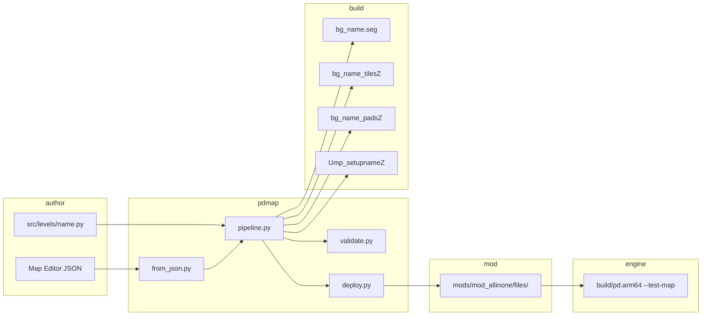

# Spec: Map Creation (normative)

**Spec IDs:** `R-MAP-01` … `R-MAP-34` in [`SPEC.md`](../../SPEC.md)  
**Generated invariants (do not hand-edit):** [`../MAP_DETERMINISTIC_SPEC.md`](../MAP_DETERMINISTIC_SPEC.md)  
**Operator wiki:** [`../MAP_MAKING_WIKI.md`](../MAP_MAKING_WIKI.md) · **Binary deep reference:** [`../MAP_CREATION.md`](../MAP_CREATION.md)

This document is the **single consolidated normative spec** for authoring custom multiplayer arenas in this repository. Numbers and paths are taken from `tools/pdmap/` and engine sources.

---

## 1. Five-file contract

Every playable arena stage `<name>` requires these assets:

| # | Deployed filename | Role | Built under |
|---|-------------------|------|-------------|
| 1 | `bgdata/bg_<name>.seg` | Room geometry (F3DEX2) + room bboxes | `BUILD_DIR` |
| 2 | `bgdata/bg_<name>_tilesZ` | Collision floor tiles (RareZip) | `BUILD_DIR` |
| 3 | `bgdata/bg_<name>_padsZ` | Pad anchors + waypoint graph (RareZip) | `BUILD_DIR` |
| 4 | `Ump_setup<name>Z` | MP setup (intro cmds: spawns, weapons, scenarios) | `SETUP_DIR` |
| 5 | `Usetup<name>Z` | Solo setup alias (copy of MP setup for dedicated stages) | parent of `bgdata/` in mod |

**Optional:** floor **props** (weapons, ammo crates) are packed into the setup binary via `MapDef.props` — not a separate deployed file.

**Verify (uff test slot after build+deploy):**

```bash
python3 tools/pdmap.py build uff --seg --deploy
test -f build/ntsc-final/assets/files/bgdata/bg_uff.seg
test -f build/ntsc-final/assets/files/bgdata/bg_uff_tilesZ
test -f build/ntsc-final/assets/files/bgdata/bg_uff_padsZ
test -f build/ntsc-final/Ump_setupuffZ
test -f mods/mod_allinone/files/bgdata/bg_uff.seg
# EXPECT: all test -f succeed; deploy log contains "Deployed bg_uff"
```

---

## 2. Canonical paths

From `tools/pdmap/core.py`:

| Symbol | Path |
|--------|------|
| `ROOT` | Repository root |
| `ROMID` | `ntsc-final` |
| `BUILD_DIR` | `build/ntsc-final/assets/files/bgdata/` |
| `SETUP_DIR` | `build/ntsc-final/` |
| `SEG_SRC` | `build/ntsc-final/assets/files/seg/` |
| Level modules | `src/levels/<name>.py` |
| Tiles JSON | `src/assets/ntsc-final/tiles/<name>.json` |

**Default deploy targets (`MOD_DIRS`):**

```text
mods/mod_allinone/files/bgdata/
mods/mod_kakariko/files/bgdata/
mods/mod_moyoteg/files/bgdata/
```

Setup binaries deploy to the **parent** of each mod's `bgdata/` (e.g. `mods/mod_allinone/files/Ump_setupuffZ`).

**Verify MOD_DIRS count:**

```bash
python3 -c "from tools.pdmap.core import MOD_DIRS; assert len(MOD_DIRS)==3; print('OK', MOD_DIRS[0])"
# EXPECT: OK .../mods/mod_allinone/files/bgdata
```

---

## 3. Coordinate system

| Rule | Value | Source |
|------|-------|--------|
| Up axis | **+Y** | Right-handed Y-up |
| Floor tiles | **Y = 0** | `floor_box_tiles`, box arena convention |
| Pad floor offset | **`PAD_FLOOR_OFFSET = 10.0`** | `tools/pdmap/builders.py:1352` |
| Scale in JSON/binaries | Coordinates × **6** in asset JSON (`to_scaled_hex`) | `core.py:to_scaled_hex` |

**SHALL:** Spawn, weapon, and scenario pads use **Y = 10.0** (or greater small positive). Ground search requires `floor_y < pad_y`; **Y ≤ 0** pads fall through.

**SHALL NOT:** Use **Y ≥ 20+** for spawns routinely — fall damage on spawn. Validator warns at **Y > 200**.

**Verify pad Y autocorrect (curriculum step 11):**

```bash
./scripts/play-learn-step.sh 11 --no-play 2>&1 | rg -i 'y=10|autocorrect|learn_11'
python3 tools/pdmap.py validate learn_11_y_autocorrect
# EXPECT: validate exit 0; pads at Y=10 in build output
```

---

## 4. Validation (`validate_mapdef`)

Source: `tools/pdmap/validate.py`. Run via:

```bash
python3 tools/pdmap.py validate <level_name>
# EXPECT: exit 0; prints "OK" or no errors
```

### 4.1 Hard errors (build fails)

| Rule | Message pattern |
|------|-----------------|
| Pad indices contiguous **0..N−1** matching array position | `Pad at position … has index …` |
| Pad **room ≥ −1** | `invalid room` |
| Pad **Y > 0** (unless module sets `RETAIL_GEOMETRY=True`) | `Y=… is at/below the floor` |
| Pad room exists in tiles (when tiles JSON present) | `spawns in room … but tiles have … rooms` |
| Intro contains **Spawn** | `Intro has no Spawn commands` |
| Spawn/Case/CaseRespawn/Hill reference valid pad index | `references missing pad` |
| CTF: each **Case** team has **CaseRespawn** | `has Case pad(s) but no case_respawn pad` |
| Prop pack succeeds | `Prop[i] pack failed` |
| Seg **G_VTX** valid (when seg built) | `Seg G_VTX:` |

### 4.2 Warnings (non-blocking)

| Condition | Warning |
|-----------|---------|
| Y > 200 | fall damage risk |
| No Case commands | CTF won't work |
| No Hill commands | KOTH won't work |
| First intro cmd not Spawn | ordering hint |
| Missing seg/setup file | rebuild hint |

**Verify contiguous pads (negative test):**

```bash
python3 tools/pdmap.py validate learn_01_spawn
# EXPECT: exit 0

# Curriculum probe: non-contiguous pads fail validate_curriculum step checks
python3 -c "from tools.pdmap.learn.curriculum import validate_curriculum; r=validate_curriculum(); print(sum(1 for x in r if x.ok), '/', len(r))"
# EXPECT: 31 / 31
```

### 4.3 Generated invariants

Run the learn engine to refresh [`MAP_DETERMINISTIC_SPEC.md`](../MAP_DETERMINISTIC_SPEC.md):

```bash
python3 tools/pdmap.py learn run
# EXPECT: updates docs/MAP_DETERMINISTIC_SPEC.md — do not hand-edit that file
```

---

## 5. Seg modes (`PDMAP_SEG_MODE`)

Set via environment before seg build (`pipeline.py` sets defaults from map content).  
Source: `tools/pdmap/seg.py` docstring + `build_from_module` logic.

| Mode | When to use | Visual | FPS `--test-map` safe? |
|------|-------------|--------|------------------------|
| **`empty`** | Default box arenas; curriculum steps 1–9, 11–13, 15+ | Setup GDL only — no wall sheet | **Yes** |
| **`full`** | Editor preview; step 14 lesson | All 6 box faces | No — near-plane clip |
| **`hill`** | Map has KOTH Hill intro; steps 7, 13, 28 | Floor quads for arena + hill marker | Yes |
| **`ctf`** | Map has Case/CaseRespawn; steps 8, 10, 12, 16, 25, 26 | Floor quads per team zones | Yes |
| **`marker`** | Overlap-pad / cover lessons; steps 20, 31 | Grey arena + green centre square | Yes |
| `walls` / `box` | Legacy alias — ceiling + 4 walls, no floor | Editor preview | No |
| `floor` | Floor quad only | Single floor face | Yes |
| `debug` / `rainbow` | Diagnosis (same faces as `full`) | High-contrast per face | No |
| `parade` / `parade_districts` | Animation lab only | Category slot squares | N/A for box curriculum |

**Auto-selection in `build_from_module`:** `SEG_MODE` module attr → else `anim_parade` → else CTF zones → else hill center → else `CENTER_MARKER` → else **`empty`** for box dims.

**Verify empty vs full (steps 14–15):**

```bash
PDMAP_SEG_MODE=empty python3 tools/pdmap.py build learn_15_seg_empty --seg --deploy 2>&1 | rg -i seg
PDMAP_SEG_MODE=full  python3 tools/pdmap.py build learn_14_procedural_seg --seg --deploy 2>&1 | rg -i seg
./scripts/play-learn-step.sh 15 --no-play
# EXPECT: step 15 log shows PDMAP_SEG_MODE=empty; step 14 used full
```

**SHALL:** Reject corrupt seg at deploy (`deploy.py` calls `validate_seg_g_vtx` — G_VTX count nibble max **16**, use **G_VTX(4)** per face).

---

## 6. Deploy

Functions in `tools/pdmap/deploy.py`:

| Function | Purpose |
|----------|---------|
| `deploy(name, mod_dirs=None, deploy_as=None)` | Copy seg, tilesZ, padsZ to mod bgdata |
| `deploy_setup(name, …, deploy_as=None)` | Copy `Ump_setup` + `Usetup` to mod files/ |
| `deploy_all(…)` | All asset types; honors `include_tiles/seg/pads/setup` flags |

**`deploy_as`:** Build from level module `<name>`, install as retail slot `<asset_name>`:

```bash
python3 tools/pdmap.py build learn_09_deploy_uff --deploy
# Module learn_09_deploy_uff → deploys bg_uff.* when DEPLOY_AS='uff'
# EXPECT log: Deploy-as: learn_09_deploy_uff → uff (retail slot)
```

**CLI:**

```bash
python3 tools/pdmap.py build <level> --deploy [--mod mods/mod_allinone]
python3 tools/pdmap.py from-json map.json --deploy-as uff --deploy
```

**Verify deploy mtimes:**

```bash
python3 tools/pdmap.py build uff --seg --deploy
stat -f '%Sm' mods/mod_allinone/files/bgdata/bg_uff.seg
# EXPECT: mtime within last minute
```

---

## 7. Stage registration

Custom stages must be wired in four C locations (see [`../MAP_CREATION.md`](../MAP_CREATION.md) §1 for detail):

1. `src/include/files.h` — `FILE_*` constants  
2. `src/assets/ntsc-final/files/list.c` — path strings  
3. `src/game/stagetable.c` — `g_Stages[]` row  
4. `src/game/mplayer/setup.c` — `g_MpArenas[]` + `groups[]` menu indices  

### 7.1 Built-in test stages (this repo)

| Symbol | Hex | Decimal | Assets | Boot |
|--------|-----|---------|--------|------|
| `STAGE_TEST_UFF` | **`0x4d`** | 77 | `bg_uff.*` | `--test-map` or `--boot-stage 0x4d` |
| `STAGE_MY_ARENA` | **`0x80`** | 128 | `bg_my_arena.*` | `--boot-stage 0x80` |

Engine references:

- `src/include/constants.h` — `#define STAGE_TEST_UFF 0x4d`, `STAGE_MY_ARENA 0x80`
- `src/game/stagetable.c` — rows for uff and my_arena file IDs
- `src/game/mplayer/setup.c` — `{ STAGE_TEST_UFF, 0, 0x7FFF }`, `{ STAGE_MY_ARENA, 0, 0x7FFD }`
- `src/game/title.c` — `--test-map` → `STAGE_TEST_UFF`, `chrslots = 0x01`

**Register new stage (dry-run):**

```bash
python3 tools/pdmap.py register my_arena --dry-run
# EXPECT: plan written to journal/map_learn/register_my_arena.md (or stdout)
rg 'STAGE_MY_ARENA|stagetable' journal/map_learn/register_my_arena.md
```

**Verify my_arena registration (step 16):**

```bash
./scripts/play-learn-step.sh 16 --no-play 2>&1 | rg -i 'my_arena|0x7FFD|scenario-5'
```

---

## 8. Editor JSON → engine pipeline

### 8.1 Data flow



### 8.2 Commands

**From JSON (no level module required):**

```bash
python3 tools/pdmap.py from-json journal/map_learn/maps/learn_01_spawn.json \
  --deploy-as uff --seg --deploy
# EXPECT: validate OK, deploy log, bg_uff.* in mod
```

**Editor Test/Play one-shot:**

```bash
python3 journal/uff_viewer/test_map.py journal/map_learn/maps/learn_01_spawn.json \
  --level uff --seg --deploy --play
# EXPECT: build + deploy + launches pd.arm64 with --test-map
```

**Equivalent CLI play after deploy:**

```bash
./build/pd.arm64 --test-map --scenario-0 --basedir data \
  --moddir mods/mod_allinone --savedir . --num-sims 0
# EXPECT: loads STAGE_TEST_UFF / bg_uff assets from mod
```

**Persist level module from JSON:**

```bash
python3 tools/pdmap.py from-json map.json --write-level --deploy-as uff
# EXPECT: writes src/levels/<name>.py
```

---

## 9. Setup, bots, and simulants

| Requirement | Value | Source |
|-------------|-------|--------|
| MP simulant ailist | id **`0x1000`** (`mp_init_simulants`) | `core.py:MapDef.pack_setup` |
| Loadout intro | `add_loadout_intro()` — standard weapons + ammo | `builders.py` |
| Waypoint neighbours | **K_NEAREST = 6**, symmetric reciprocal edges | `core.py:MapDef.pack_pads_json` |
| Quick-team chrslots | **`0x01`** when `--test-map` | `title.c` |
| Stock bot cap | **4** sims spawn (8 requested without 8-bot feature) | step 23 curriculum |

**Verify ailist 0x1000 (step 5):**

```bash
./scripts/play-learn-step.sh 5 --no-play 2>&1 | rg -i 'loadout|0x1000|learn_05'
python3 tools/pdmap.py validate learn_05_loadout
# EXPECT: validate exit 0
```

**Verify bot waypoint graph (step 6):**

```bash
./scripts/play-learn-step.sh 6 2>&1 | tee /tmp/step6.log
# EXPECT: --num-sims 1 in launch argv; game boots without waypoint crash
rg 'scenario-0|num-sims' /tmp/step6.log
```

---

## 10. Curriculum integration

Full step table: [`CURRICULUM.md`](CURRICULUM.md).

**Global validate:**

```bash
python3 -c "
from tools.pdmap.learn.curriculum import validate_curriculum
r = validate_curriculum(verbose=True)
bad = [x for x in r if not x.ok]
assert not bad, bad
print(f'{len(r)}/31 steps OK')
"
# EXPECT: 31/31 steps OK
```

**Launch step N:**

```bash
./scripts/play-learn-step.sh 7
# EXPECT: deploy learn_07 → uff slot; --scenario-4 (KOTH)
```

---

## 11. CLI flags (map author subset)

Full table (including out-of-scope War Colors probes): [`CLI_AND_LIMITS.md`](CLI_AND_LIMITS.md).

| Flag | Map author use |
|------|----------------|
| `--test-map` | Boot **`STAGE_TEST_UFF`** (`0x4d`) with last-deployed `bg_uff.*` |
| `--boot-stage 0x80` | Boot **`STAGE_MY_ARENA`** without test-map shortcut |
| `--scenario-0` … `--scenario-5` | Combat, Hold, Hacker, Pop-a-Cap, KOTH, CTF |
| `--num-sims N` | Bot count (default **8**; stock cap **4** bots) |
| `--solo` / `--num-sims 0` | Human only |
| `--moddir mods/mod_allinone` | **Required** for custom assets |

---

## 12. Copy-paste acceptance suite

Run from repo root after `make -j8` and ROM in `data/pd.ntsc-final.z64`:

```bash
# 1. Full curriculum validation
python3 -c "from tools.pdmap.learn.curriculum import validate_curriculum; r=validate_curriculum(verbose=True); assert len([x for x in r if not x.ok])==0"

# 2. Build + deploy uff test slot
python3 tools/pdmap.py build uff --seg --deploy

# 3. Validate stock test map
python3 tools/pdmap.py validate uff

# 4. JSON → deploy pipeline
python3 tools/pdmap.py from-json journal/map_learn/maps/learn_01_spawn.json --deploy-as uff --seg --deploy

# 5. Curriculum step launch (no GUI): deploy only
./scripts/play-learn-step.sh 1 --no-play 2>&1 | rg -i 'learn_01|Deployed bg_uff|scenario-0'

# 6. Learn engine / deterministic spec refresh
python3 tools/pdmap.py learn run

# 7. Interactive smoke (optional — opens game window)
# ./build/pd.arm64 --test-map --scenario-0 --basedir data --moddir mods/mod_allinone --savedir . --num-sims 0
```

**Expected substrings:** `31/31`, `Deployed bg_uff`, `OK`, no `validate_mapdef` errors, no `Refusing to deploy corrupt seg`.

---

## 13. Optional: retail-slot overlay pattern

For overwriting a **retail** stage's assets (not the primary box-arena path), build a named module and set **`DEPLOY_AS`** to the retail asset basename (e.g. deploy `war_colors` as `mp13`). Details live on the War Colors PR branch in [`WAR_COLORS.md`](WAR_COLORS.md). Map authors using **`uff`** / **`my_arena`** test slots do not need this.

---

*Requirement index: [`SPEC.md`](../../SPEC.md). User stories: [`STORIES.md`](../../STORIES.md). Workflow skill: [`.agents/skills/perfect-dark-workflow/SKILL.md`](../../.agents/skills/perfect-dark-workflow/SKILL.md).*
